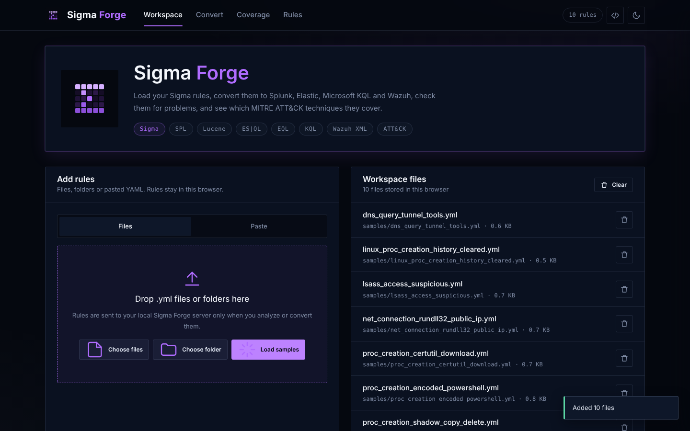
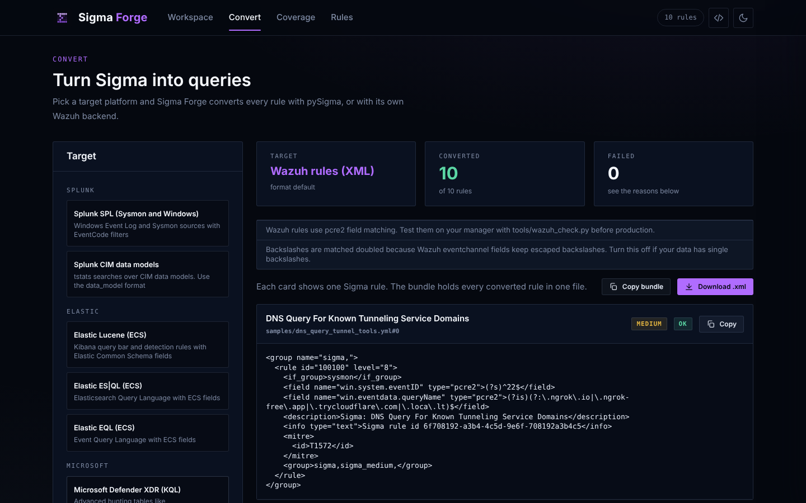
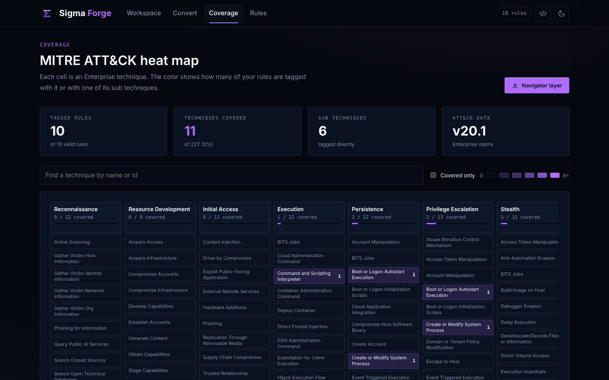
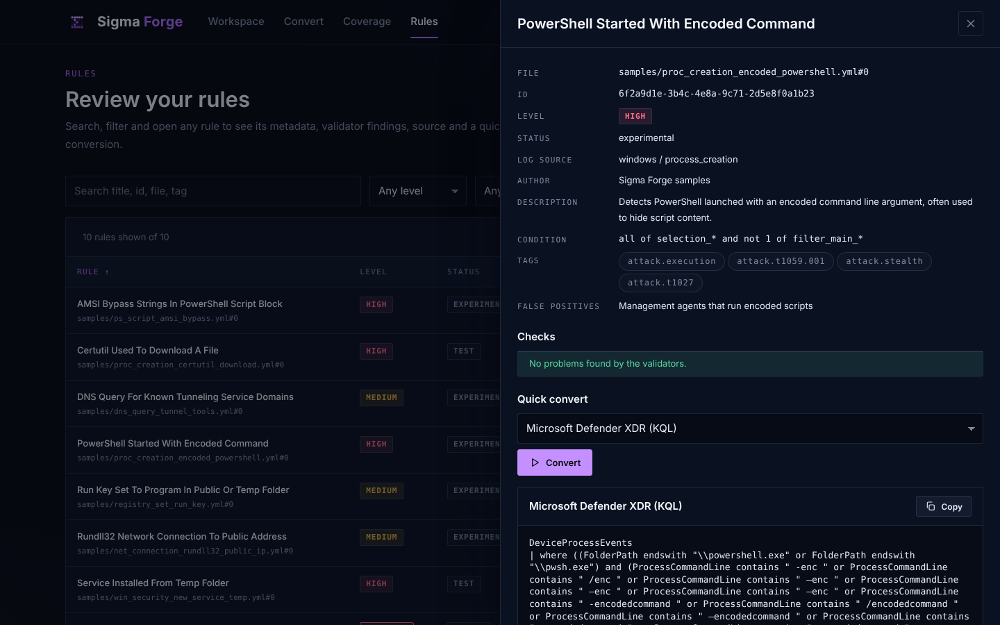
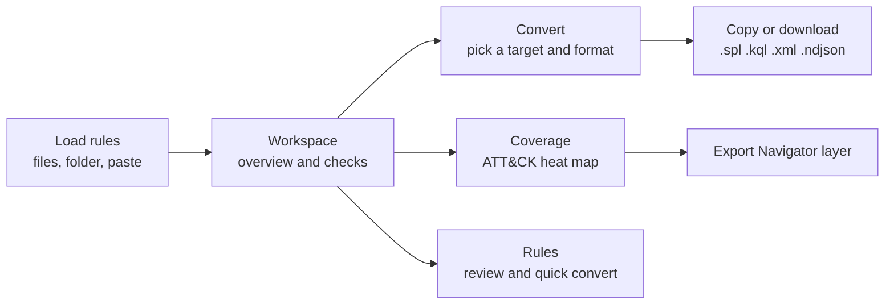
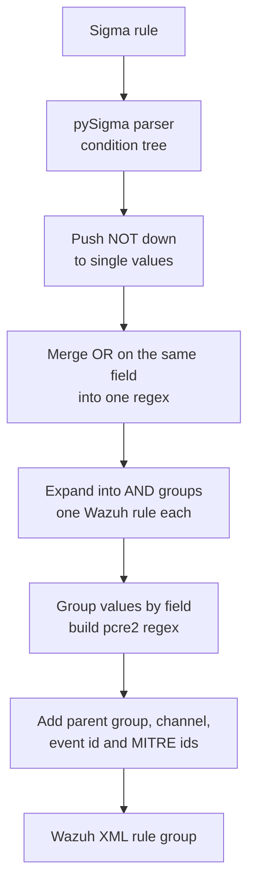
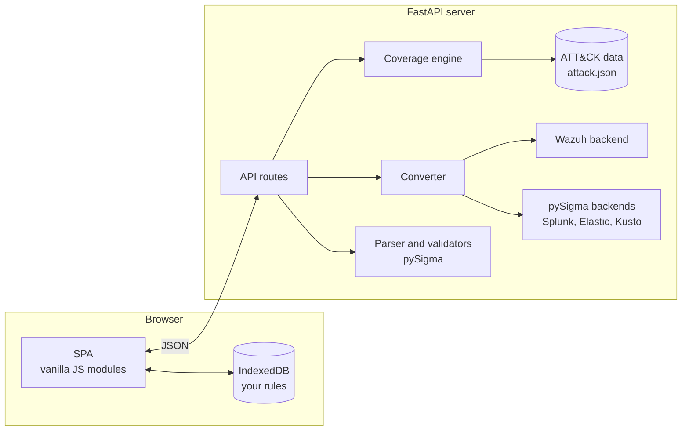

<div align="center">


# Sigma Forge

**Convert Sigma rules to Splunk, Elastic, Microsoft KQL and Wazuh. Check them for problems. See which MITRE ATT&CK techniques they cover.**

A FastAPI backend with a single page app (SPA), built on [pySigma](https://github.com/SigmaHQ/pySigma), plus a custom Wazuh rule backend.


[Features](#features) ·
[Quick start](#quick-start) ·
[Targets](#supported-targets) ·
[Wazuh backend](#the-wazuh-backend) ·
[API](#api) ·
[Project layout](#project-layout)

</div>

<br>

<p align="center">
  
</p>

## Table of contents

1. [What is Sigma Forge](#what-is-sigma-forge)
2. [Features](#features)
3. [Screenshots](#screenshots)
4. [Quick start](#quick-start)
5. [Setup script options](#setup-script-options)
6. [How to use it](#how-to-use-it)
7. [Supported targets](#supported-targets)
8. [The Wazuh backend](#the-wazuh-backend)
9. [Testing Wazuh rules on a real manager](#testing-wazuh-rules-on-a-real-manager)
10. [ATT&CK coverage](#attck-coverage)
11. [API](#api)
12. [Configuration](#configuration)
13. [Architecture](#architecture)
14. [Project layout](#project-layout)
15. [Development](#development)
16. [Known limits](#known-limits)
17. [Credits](#credits)

## What is Sigma Forge

[Sigma](https://github.com/SigmaHQ/sigma) is an open format for writing detection rules once and running them on any SIEM (Security Information and Event Management) platform. Sigma Forge is a local web app that takes a folder of Sigma rules and gives you three things:

1. **Conversion** to nine targets across Splunk, Elastic, Microsoft and Wazuh.
2. **Quality checks** with the pySigma validators, plus checks for revoked or unknown ATT&CK tags.
3. **Coverage** on a full MITRE ATT&CK (Adversarial Tactics, Techniques and Common Knowledge) Enterprise heat map, with export to ATT&CK Navigator.

Everything runs on your machine. Rules are kept in your browser (IndexedDB) and are only sent to your own Sigma Forge server when you analyze or convert them.

## Features

| Area | What you get |
|---|---|
| **Load rules** | Drag and drop files or whole folders, pick a folder, paste YAML, or load the built in samples. Multi document YAML files are supported. |
| **Convert** | Splunk SPL (Search Processing Language), Splunk CIM (Common Information Model), Elastic Lucene, ES\|QL and EQL, Microsoft Defender XDR, Sentinel ASIM and Azure Monitor KQL (Kusto Query Language), and Wazuh XML rules. Every output format of each backend is available, such as Splunk `savedsearches` or Elastic `siem_rule_ndjson`. |
| **Wazuh** | A custom backend written for Sigma Forge. It maps Sysmon and Windows fields to Wazuh `win.*` fields, picks the right parent group and event id, and turns Sigma logic into valid `pcre2` field rules. |
| **Validate** | pySigma validators (dangling detections, wildcard misuse, duplicate tags, bad modifier mixes and more) run offline, plus ATT&CK tag checks against local data. |
| **Coverage** | ATT&CK v20 Enterprise heat map with every tactic, technique counts that roll up from sub techniques, gap finding, and a Navigator layer export. |
| **Review** | Sortable and filterable rule table with a detail drawer: metadata, findings, source and a one click convert to any target. |
| **Run anywhere** | One setup script for Linux and macOS (`setup.sh`), one for Windows (`setup.ps1`), both using a Python venv, or Docker with a hardened compose file. |
| **UI** | SPA with clean URLs, dark and light themes, skeleton loading while data loads, keyboard support and a mobile layout. |

## Screenshots

<table>
  <tr>
    <td width="50%"><p align="center"><b>Convert</b>: Wazuh XML from Sigma</p></td>
    <td width="50%"><p align="center"><b>Coverage</b>: ATT&CK heat map</p></td>
  </tr>
  <tr>
    <td width="50%"><p align="center"><b>Rules</b>: detail drawer and quick convert</p></td>
    <td width="50%"><p align="center"><b>Workspace</b>: load rules and see an overview</p></td>
  </tr>
</table>

## Quick start

You need **Python 3.10 or newer**. Docker is optional.

### Linux and macOS

```bash
git clone https://github.com/qays3/Sigma-Forge.git
cd Sigma-Forge
chmod +x setup.sh
./setup.sh --run
```

### Windows (PowerShell)

```powershell
git clone https://github.com/qays3/Sigma-Forge.git
cd Sigma-Forge
Set-ExecutionPolicy -Scope Process -ExecutionPolicy Bypass
.\setup.ps1 -Run
```

### Docker

```bash
docker compose up -d --build
```

Then open **http://127.0.0.1:8000** and click **Load samples** to try it.

The setup scripts create a virtual environment in `.venv`, install the packages from `requirements.txt`, check the ATT&CK data and print the command to start the server. Run them again any time. They only change what is needed.

### Manual setup

If you prefer to do it by hand:

```bash
python3 -m venv .venv
source .venv/bin/activate          # Windows: .venv\Scripts\Activate.ps1
pip install -r requirements.txt
uvicorn app.main:app --host 127.0.0.1 --port 8000
```

## Setup script options

| `setup.sh` | `setup.ps1` | What it does |
|---|---|---|
| `--run` | `-Run` | Start the server after setup |
| `--dev` | `-Dev` | Install test tools and run the test suite |
| `--update-attack` | `-UpdateAttack` | Download the latest MITRE ATT&CK data |
| `--docker` | `-Docker` | Build and start with Docker Compose instead of a venv |
| `--recreate` | `-Recreate` | Delete and rebuild `.venv` |
| `--host HOST` | `-BindHost HOST` | Bind address (default `127.0.0.1`) |
| `--port PORT` | `-Port PORT` | Port (default `8000`) |
| `--help` | `-Help` | Show help |

Examples:

```bash
./setup.sh --dev                      # install, then run the tests
./setup.sh --update-attack --run      # refresh ATT&CK data and start
./setup.sh --host 0.0.0.0 --port 9000 --run
```

```powershell
.\setup.ps1 -Dev
.\setup.ps1 -UpdateAttack -Run
.\setup.ps1 -BindHost 0.0.0.0 -Port 9000 -Run
```

## How to use it



1. **Workspace.** Drop rule files or a folder on the drop zone, or click **Load samples**. You see how many rules parsed, how many have errors or findings, and a breakdown by level and log source.
2. **Convert.** Pick a target on the left, choose an output format, select the rules, and press **Convert**. Each rule gets its own card with the query, any warnings and a copy button. **Download** saves all converted rules as one file.
3. **Coverage.** The heat map shows every ATT&CK Enterprise tactic and technique. Darker purple means more rules. Click a technique to see its sub techniques and the rules that cover it. Use **Covered only** to hide gaps, or keep them visible to find what to write next. **Navigator layer** downloads a JSON layer for [ATT&CK Navigator](https://mitre-attack.github.io/attack-navigator/).
4. **Rules.** Search and filter by level, status, product, tactic or check state. Click a row to open the detail drawer with metadata, validator findings, the rule source and a quick convert to any target.

## Supported targets

| Target | Backend | Pipelines | Formats |
|---|---|---|---|
| Splunk SPL (Sysmon and Windows) | `splunk` | `sysmon`, `splunk_windows` | `default`, `savedsearches`, `data_model` |
| Splunk CIM data models | `splunk` | `splunk_cim` | `data_model` |
| Elastic Lucene (ECS) | `lucene` | `ecs_windows` | `default`, `kibana_ndjson`, `dsl_lucene`, `siem_rule`, `siem_rule_ndjson` |
| Elastic ES\|QL (ECS) | `esql` | `ecs_windows` | `default`, `kibana_ndjson`, `siem_rule`, `siem_rule_ndjson` |
| Elastic EQL (ECS) | `eql` | `ecs_windows` | `default`, `eqlapi`, `siem_rule`, `siem_rule_ndjson` |
| Microsoft Defender XDR (KQL) | `kusto` | `microsoft_xdr` | `default` |
| Microsoft Sentinel ASIM (KQL) | `kusto` | `sentinel_asim` | `default` |
| Azure Monitor (KQL) | `kusto` | `azure_monitor` | `default` |
| Wazuh rules (XML) | Sigma Forge | built in field mapping | `default` |

ECS means Elastic Common Schema. ASIM means Advanced Security Information Model.

Some pipelines only support some log sources. For example, the Splunk CIM pipeline does not map network connection or DNS rules, and the KQL pipelines need a known table for each log source. When a rule cannot be converted, its card shows the reason from pySigma instead of failing the whole run.

To add a target, install another pySigma backend with pip and add one line to `TARGETS` in [`app/core/targets.py`](app/core/targets.py).

## The Wazuh backend

There is no maintained pySigma backend for Wazuh, so Sigma Forge ships its own in [`app/core/wazuh`](app/core/wazuh). It reads the condition tree that pySigma builds and writes Wazuh XML rules.



**Field mapping.** For Windows rules, Sysmon and Security fields become Wazuh eventchannel fields: `Image` becomes `win.eventdata.image`, `CommandLine` becomes `win.eventdata.commandLine`, and `EventID` becomes `win.system.eventID`. System fields such as `Channel`, `Provider_Name` and `Computer` map to `win.system.*`.

**Parent and event filter.** The log source decides the parent and extra filters:

| Sigma log source | Wazuh rule gets |
|---|---|
| `category: process_creation` (and other Sysmon categories) | `<if_group>sysmon</if_group>` and the Sysmon event id, for example `1` |
| `category: ps_script` / `ps_module` | `<if_group>windows</if_group>`, the PowerShell channel and event `4104` / `4103` |
| `service: security`, `system`, `powershell` and more | `<if_group>windows</if_group>` and the channel name |
| Other products (Linux and so on) | No parent. Field names stay as they are and a warning is shown |

**Logic.** Wazuh rules are a list of conditions that must all match, so Sigma logic is rewritten:

* Values joined by OR on the same field become one regex such as `(?:\\powershell\.exe|\\pwsh\.exe)$`.
* OR across different fields becomes several Wazuh rules with the same description. The split is capped (default 64) so a rule never explodes.
* AND on the same field, such as `contains|all`, becomes one regex with lookaheads.
* NOT becomes `negate="yes"` or a negative lookahead.
* Matching is case insensitive like Sigma, unless the rule uses the `cased` modifier.

**Example output** for the sample rule `dns_query_tunnel_tools.yml`

```xml
<group name="sigma,">
  <rule id="100100" level="8">
    <if_group>sysmon</if_group>
    <field name="win.system.eventID" type="pcre2">(?s)^22$</field>
    <field name="win.eventdata.queryName" type="pcre2">(?is)(?:\.ngrok\.io|\.ngrok-free\.app|\.trycloudflare\.com|\.loca\.lt)$</field>
    <description>Sigma: DNS Query For Known Tunneling Service Domains</description>
    <info type="text">Sigma rule id 6f708192-a3b4-4c5d-9e6f-708192a3b4c5</info>
    <mitre>
      <id>T1572</id>
    </mitre>
    <group>sigma,sigma_medium,</group>
  </rule>
</group>
```

**Options** (on the Convert page or in the API):

| Option | Default | Why |
|---|---|---|
| First rule id | `100100` | Custom Wazuh rules should use ids from 100000 up |
| Match doubled backslashes | on | Wazuh eventchannel fields keep Windows paths with escaped backslashes (`C:\\Windows`). Turn it off if your decoder gives single backslashes |
| Add if_group parent | on | Ties the rule to the Sysmon or Windows rule tree |

Sigma levels map to Wazuh levels like this: informational 3, low 5, medium 8, high 12, critical 15.

**Install the rules.** Download the `.xml` from the Convert page, copy it to `/var/ossec/etc/rules/` on the manager, and restart it:

```bash
sudo cp sigma-forge_wazuh.xml /var/ossec/etc/rules/sigma_forge_rules.xml
sudo chown wazuh:wazuh /var/ossec/etc/rules/sigma_forge_rules.xml
sudo systemctl restart wazuh-manager
```

## Testing Wazuh rules on a real manager

[`tools/wazuh_check.py`](tools/wazuh_check.py) uploads the rules through the Wazuh API (Application Programming Interface), restarts the manager and runs test events through the `logtest` endpoint.

```bash
.venv/bin/python tools/wazuh_check.py \
  --url https://WAZUH_MANAGER:55000 \
  --user wazuh --password 'YOUR_PASSWORD' \
  --rules sigma-forge_wazuh.xml \
  --events samples/events/wazuh_eventchannel.jsonl \
  --insecure
```

On Windows use `.venv\Scripts\python.exe` instead. The password can also come from the `WAZUH_API_PASSWORD` variable. Use `--insecure` only for lab managers with self signed certificates.

Each line of the events file is one test:

```json
{"name": "Certutil download", "expect": "Certutil Used To Download A File", "event": {"win": {"system": {"eventID": "1"}, "eventdata": {"image": "C:\\Windows\\System32\\certutil.exe"}}}}
```

`expect` can be a rule id (`100104`), part of the rule title, or `none` for events that must not fire a Sigma rule. The tool prints PASS or FAIL for each line and exits with code 1 if any test fails, so you can use it in a pipeline.

## ATT&CK coverage

The ATT&CK Enterprise data lives in [`data/attack/attack.json`](data/attack/attack.json), a small file (about 130 KB) built from the official [MITRE ATT&CK STIX data](https://github.com/mitre-attack/attack-stix-data). It is included in the repo, so coverage works offline.

Refresh it at any time:

```bash
./setup.sh --update-attack                 # Linux and macOS
.\setup.ps1 -UpdateAttack                  # Windows
.venv/bin/python tools/fetch_attack.py     # direct
```

How tags are read:

* `attack.t1059.001` counts for T1059.001, and rolls up to T1059 on the heat map.
* `attack.execution` style tags count per tactic.
* Revoked techniques are moved to their new id. For example, ATT&CK v20 replaced `T1562.001` with `T1685`. The rule gets a finding and the coverage counts the new id.
* Tags that do not exist at all are listed as unknown.

## API

The server has interactive docs at **http://127.0.0.1:8000/api/docs**.

| Method | Path | What it does |
|---|---|---|
| `GET` | `/api/health` | App version, pySigma version and ATT&CK data version |
| `GET` | `/api/targets` | Targets with their formats and whether they are installed |
| `GET` | `/api/samples` | Built in sample rules |
| `GET` | `/api/attack` | ATT&CK Enterprise matrix used by the heat map |
| `POST` | `/api/analyze` | Parse and validate rules, return metadata and findings |
| `POST` | `/api/convert` | Convert rules to a target and format |
| `POST` | `/api/coverage` | ATT&CK coverage for the rules |
| `POST` | `/api/coverage/navigator` | ATT&CK Navigator layer JSON |

Rules are always sent as a list of `{name, content}` objects:

```bash
curl -s http://127.0.0.1:8000/api/convert \
  -H "Content-Type: application/json" \
  -d '{
        "target": "defender_xdr",
        "format": "default",
        "rules": [{"name": "whoami.yml", "content": "title: Whoami\nlogsource:\n  product: windows\n  category: process_creation\ndetection:\n  sel:\n    Image|endswith: \"\\\\whoami.exe\"\n  condition: sel\nlevel: low"}]
      }'
```

Wazuh options go in `options`:

```json
{"target": "wazuh", "rules": [], "options": {"wazuh_rule_id_start": 110000, "wazuh_double_backslash": false, "wazuh_parent_group": true}}
```

## Configuration

Set these as environment variables. See [`.env.example`](.env.example).

| Variable | Default | Meaning |
|---|---|---|
| `SIGMA_FORGE_HOST` | `127.0.0.1` | Bind address (`0.0.0.0` in Docker) |
| `SIGMA_FORGE_PORT` | `8000` | Port |
| `SIGMA_FORGE_MAX_RULES` | `5000` | Most files per request |
| `SIGMA_FORGE_MAX_RULE_BYTES` | `262144` | Largest file size per rule file |
| `SIGMA_FORGE_WAZUH_ID_START` | `100100` | Default first Wazuh rule id |
| `SIGMA_FORGE_WAZUH_MAX_SPLIT` | `64` | Most Wazuh rules made from one Sigma rule |
| `WAZUH_API_URL` | `https://127.0.0.1:55000` | Used by `wazuh_check.py` |
| `WAZUH_API_USER` | `wazuh` | Used by `wazuh_check.py` |
| `WAZUH_API_PASSWORD` | none | Used by `wazuh_check.py` |

## Architecture



* The server is stateless. It never stores rules. Each request carries the rules it needs.
* The SPA uses the History API for clean URLs (`/convert`, `/coverage`, `/rules`). FastAPI returns `index.html` for any path that is not an API route or an asset.
* All colors come from [`web/assets/css/root.css`](web/assets/css/root.css). The rest of the CSS only uses its variables, so changing that one file restyles the whole app, both themes included.

## Project layout

```text
Sigma-Forge/
├── app/
│   ├── main.py                  FastAPI app, static files, SPA fallback
│   ├── config.py                Paths and environment settings
│   ├── schemas.py               Request models
│   ├── api/
│   │   └── routes.py            /api endpoints
│   └── core/
│       ├── parsing.py           Load YAML into pySigma rules
│       ├── analyzer.py          Metadata and validators
│       ├── converter.py         Run pySigma or Wazuh conversion
│       ├── targets.py           Target list, backends and pipelines
│       ├── coverage.py          ATT&CK coverage and Navigator layer
│       ├── attack.py            ATT&CK data and tag helpers
│       └── wazuh/
│           ├── backend.py       Sigma to Wazuh XML
│           └── mapping.py       Log source and field mapping
├── web/
│   ├── index.html               SPA shell
│   └── assets/
│       ├── css/
│       │   ├── root.css         Theme tokens (the only place with colors)
│       │   └── app.css          Layout and components
│       ├── js/
│       │   ├── app.js           Startup, theme, header
│       │   ├── router.js        History API router
│       │   ├── api.js           API client
│       │   ├── store.js         IndexedDB rule store
│       │   ├── state.js         Shared cache
│       │   ├── ui.js            Helpers, drawer, toasts, skeletons
│       │   └── views/           workspace, convert, coverage, rules
│       └── img/                 Logos, banner and screenshots
├── data/attack/attack.json      Compact ATT&CK Enterprise data
├── samples/
│   ├── rules/                   Sample Sigma rules
│   └── events/                  Wazuh test events
├── tools/
│   ├── fetch_attack.py          Build attack.json from MITRE STIX
│   └── wazuh_check.py           Upload and test rules on a Wazuh manager
├── tests/                       pytest suite
├── setup.sh                     Linux and macOS setup
├── setup.ps1                    Windows setup
├── Dockerfile
├── docker-compose.yml
├── requirements.txt
└── requirements-dev.txt
```

## Development

```bash
./setup.sh --dev            # or .\setup.ps1 -Dev
.venv/bin/python -m pytest -q
.venv/bin/python -m uvicorn app.main:app --reload
```

The tests cover the API, every target, error handling, coverage, and the Wazuh backend. The Wazuh tests compile the generated regex and check it against real looking field values, so they catch broken escaping and wrong logic, not only bad XML.

Adding a sample rule is as simple as dropping a `.yml` file in `samples/rules/`. It shows up under **Load samples** right away.

## Known limits

* **Wazuh** has no number compare for normal fields, so the `lt`, `lte`, `gt` and `gte` modifiers fail with a clear message. `cidr` is turned into a text prefix match. The `fieldref` modifier is not supported. Always test the rules with `wazuh_check.py` before production.
* **Correlation rules** (Sigma v2 meta rules) are listed but not converted.
* **Pipelines** only know the log sources their authors mapped. Rules for other log sources show the pySigma error on their card.
* **Elastic Lucene** regex is not PCRE (Perl Compatible Regular Expressions), so rules with complex `re` values may need a manual check.

## Credits

* [SigmaHQ](https://github.com/SigmaHQ) for the Sigma format and [pySigma](https://github.com/SigmaHQ/pySigma) with its backends and pipelines.
* [MITRE ATT&CK®](https://attack.mitre.org/). © The MITRE Corporation. This work is reproduced and distributed with the permission of The MITRE Corporation.
* [Wazuh](https://wazuh.com/), [Splunk](https://www.splunk.com/), [Elastic](https://www.elastic.co/) and [Microsoft](https://learn.microsoft.com/en-us/kusto/query/) are trademarks of their owners. Sigma Forge is not tied to any of them.

<div align="center">
<br>

<br>
<sub>Built by <a href="https://qayssarayra.com">Qays Sarayra</a></sub>
</div>
