<div align="center">

<picture>
  <source media="(prefers-color-scheme: dark)" srcset="web/assets/img/banner.png">
  <source media="(prefers-color-scheme: light)" srcset="web/assets/img/banner-light.png">
  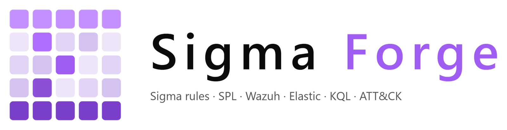
</picture>

Convert Sigma rules to 31 SIEM, EDR and log platforms, check them for problems, and see which MITRE ATT&CK techniques they cover.


</div>

## Table of contents

1. [What is Sigma Forge](#what-is-sigma-forge)
2. [Features](#features)
3. [Screenshots](#screenshots)
4. [Quick start](#quick-start)
5. [Setup script options](#setup-script-options)
6. [How to use it](#how-to-use-it)
7. [Sample pack](#sample-pack)
8. [Supported targets](#supported-targets) and [target guide](#target-guide)
9. [Automatic fallbacks](#automatic-fallbacks)
10. [Correlation rules](#correlation-rules)
11. [ATT&CK coverage](#attck-coverage)
12. [Testing rules on logs](#testing-rules-on-logs)
13. [SigmaHQ library](#sigmahq-library)
14. [Field mapping](#field-mapping)
15. [Export packages](#export-packages)
16. [API](#api)
17. [Configuration](#configuration)
18. [Architecture](#architecture)
19. [Project layout](#project-layout)
20. [Development](#development)
21. [Known limits](#known-limits)
22. [Credits](#credits)

## What is Sigma Forge

[Sigma](https://github.com/SigmaHQ/sigma) is an open format for writing detection rules once and running them on any SIEM (Security Information and Event Management) platform. Sigma Forge is a local web app that takes a folder of Sigma rules and helps you write, check, test, convert and ship them:

1. **Conversion** to 31 targets across 19 platforms: Splunk, Elastic, OpenSearch, Microsoft, CrowdStrike, SentinelOne, Palo Alto, Google SecOps, Carbon Black, QRadar, Wazuh and more, with ready to deploy packages for each.
2. **Quality checks** with the pySigma validators, plus checks for revoked or unknown ATT&CK tags, live in a rule editor.
3. **Testing** on your own EVTX or JSON logs, so you see which rules fire before you deploy them.
4. **Coverage** on a full MITRE ATT&CK (Adversarial Tactics, Techniques and Common Knowledge) Enterprise heat map, by technique and by log source, with gap suggestions from the SigmaHQ library and export to ATT&CK Navigator.

Everything runs on your machine. Rules are kept in your browser (IndexedDB) and are only sent to your own Sigma Forge server when you analyze or convert them.

## Features

| Area | What you get |
|---|---|
| **Load rules** | Drag and drop files or whole folders, pick a folder, paste YAML, load the built in sample pack (which includes one rule for every Enterprise technique) or rules from the SigmaHQ library. Multi document files and `action: global` collections are supported. |
| **Editor** | Write a rule with templates, line numbers and live checks. The query for any target and the ATT&CK mapping update as you type. Save to the workspace with Ctrl+S. |
| **Correlations** | Sigma correlation rules (`event_count`, `value_count`, `temporal`) are parsed, listed and converted on every target whose backend supports them. |
| **Convert** | 31 targets: Splunk SPL, SPL2 and CIM, Elastic Lucene, ES\|QL, EQL and ElastAlert, OpenSearch Lucene and PPL, Microsoft KQL (Defender XDR, Sentinel ASIM, Azure Monitor), CrowdStrike LogScale, SentinelOne, Cortex XDR, Google SecOps UDM and YARA-L, Carbon Black, QRadar AQL, Logpoint, NetWitness, Sumo Logic, Panther, Trellix Helix, Grafana Loki, Quickwit, ClickHouse, SQLite (Zircolite), SurrealQL and Wazuh. Every output format of each backend is available. See the [target guide](#target-guide). |
| **Compare** | One rule, up to four platforms side by side, to see how each writes the same detection. |
| **Test on logs** | Drop EVTX, JSON or JSON lines files. Events are loaded into SQLite and every rule runs on them, correlations included. See hits, silent rules and the matching events. |
| **SigmaHQ library** | Sync the full SigmaHQ release (more than 3,000 rules) or upload the zip offline, search by technique, log source, level or status, and add rules to the workspace. |
| **Field mapping** | Profiles that rename Sigma fields to your own field names, with ECS, Wazuh and Splunk CIM presets. Used by Convert, Compare, Test, the editor and exports. |
| **Export packages** | A zip per platform ready to deploy: a Splunk app, Kibana detection rules, a Sentinel ARM template, a Wazuh rules file, a Loki ruler file, YARA-L rules, a Zircolite pack and more, each with a README and a manifest. |
| **Validate** | pySigma validators (dangling detections, wildcard misuse, duplicate tags, bad modifier mixes and more) run offline, plus ATT&CK tag checks against local data. |
| **Coverage** | ATT&CK v20 Enterprise heat map with every tactic, technique counts that roll up from sub techniques, coverage by log source, the biggest gaps compared with SigmaHQ, and a Navigator layer export. |
| **Review** | Sortable and filterable rule table with a detail drawer: metadata, findings, source and a one click convert to any target. |
| **Run anywhere** | One setup script for Linux and macOS (`setup.sh`), one for Windows (`setup.ps1`), both using a Python venv, or Docker with a hardened compose file. |
| **UI** | SPA with clean URLs, the animated Sigma Forge logo on the splash screen, header, loading panels and empty states, dark and light themes, skeleton loading while data loads, keyboard support and a mobile layout. |

## Screenshots

<table>
  <tr>
    <td width="50%"><p align="center"><b>Workspace</b>: load rules and see an overview</p></td>
    <td width="50%"><p align="center"><b>Convert</b>: Splunk SPL from the sample pack</p></td>
  </tr>
  <tr>
    <td width="50%">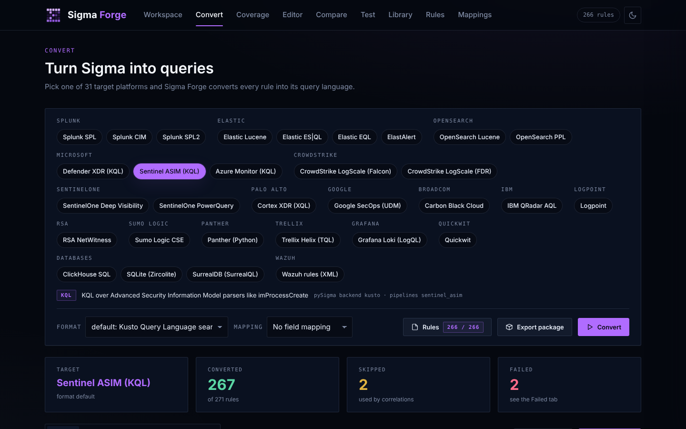<p align="center"><b>Targets</b>: 31 platforms with tips for each</p></td>
    <td width="50%"><p align="center"><b>Coverage</b>: ATT&amp;CK heat map</p></td>
  </tr>
  <tr>
    <td width="50%">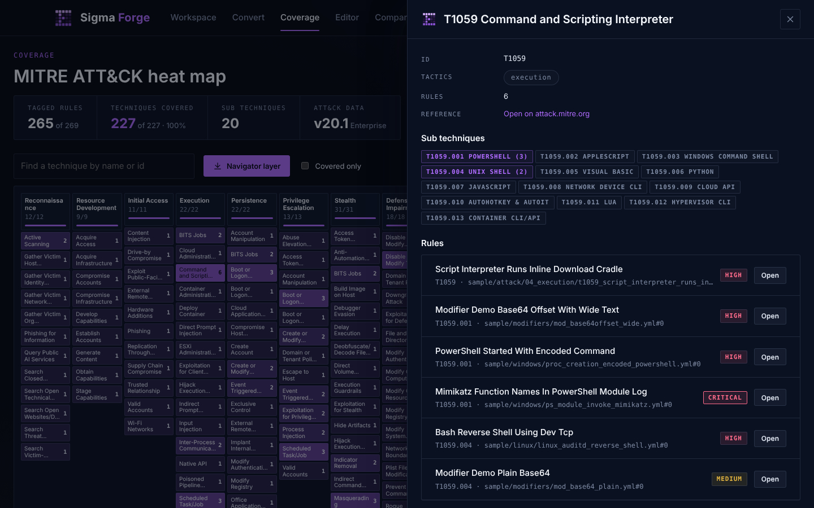<p align="center"><b>Technique</b>: sub techniques and rules</p></td>
    <td width="50%"><p align="center"><b>Rules</b>: search, filter and sort</p></td>
  </tr>
  <tr>
    <td width="50%">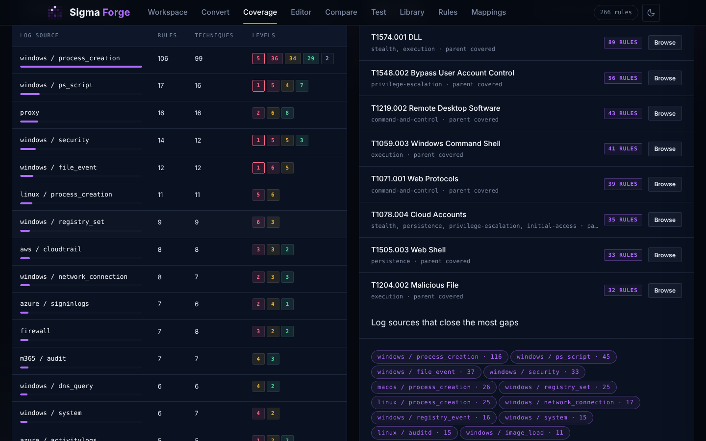<p align="center"><b>Log sources and gaps</b>: what SigmaHQ covers that you do not</p></td>
    <td width="50%">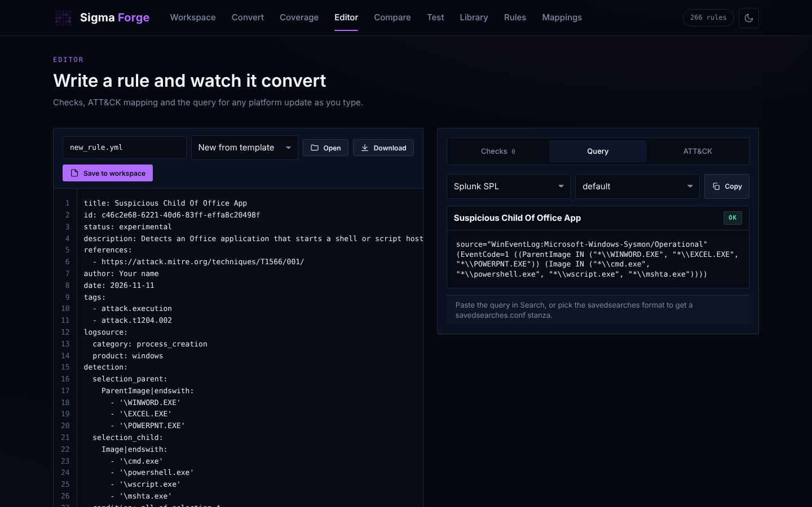<p align="center"><b>Editor</b>: live checks and queries as you type</p></td>
  </tr>
  <tr>
    <td width="50%">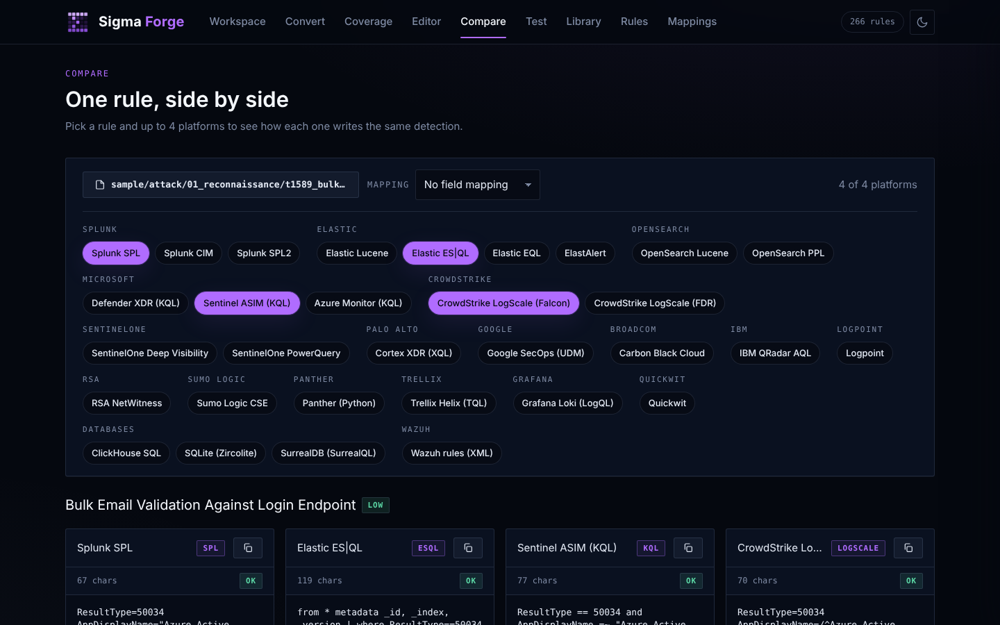<p align="center"><b>Compare</b>: one rule on four platforms</p></td>
    <td width="50%">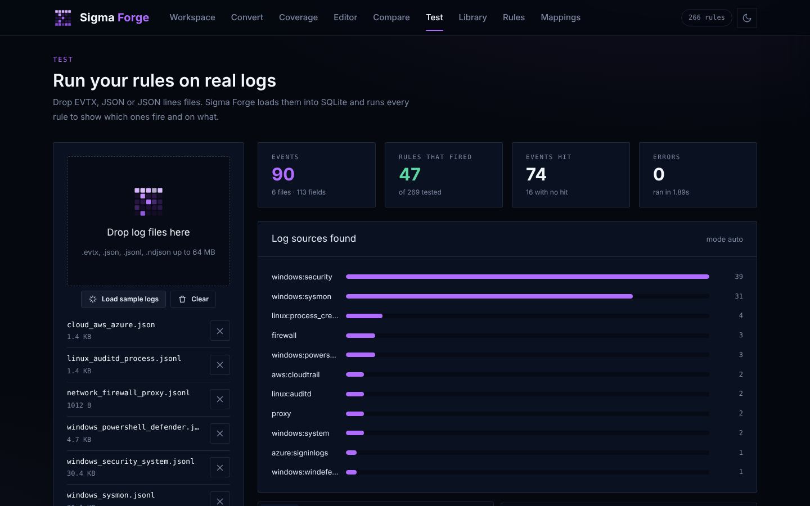<p align="center"><b>Test</b>: run rules on EVTX and JSON logs</p></td>
  </tr>
  <tr>
    <td width="50%">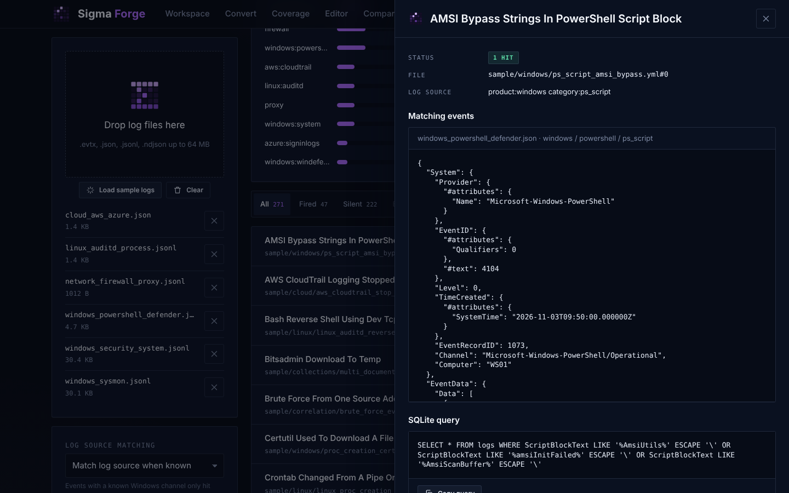<p align="center"><b>Hits</b>: the events a rule matched</p></td>
    <td width="50%">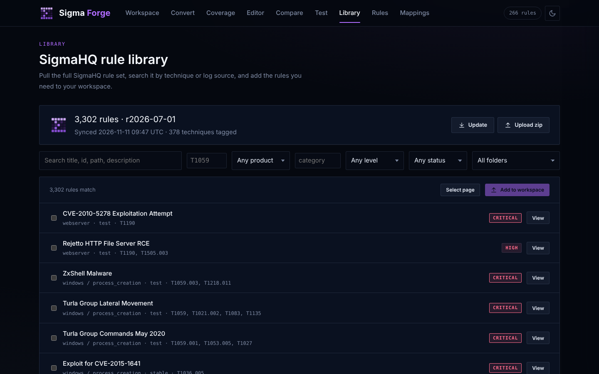<p align="center"><b>Library</b>: search and import SigmaHQ rules</p></td>
  </tr>
  <tr>
    <td width="50%">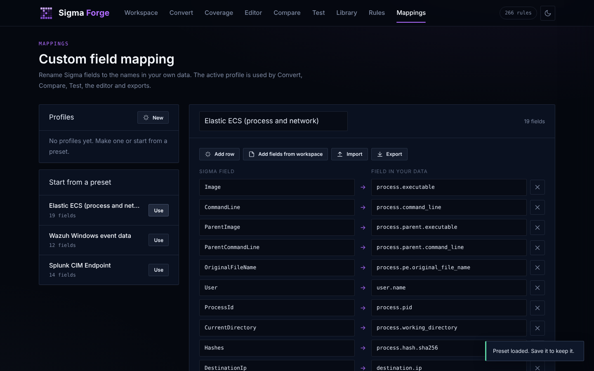<p align="center"><b>Mappings</b>: rename fields to match your data</p></td>
    <td width="50%">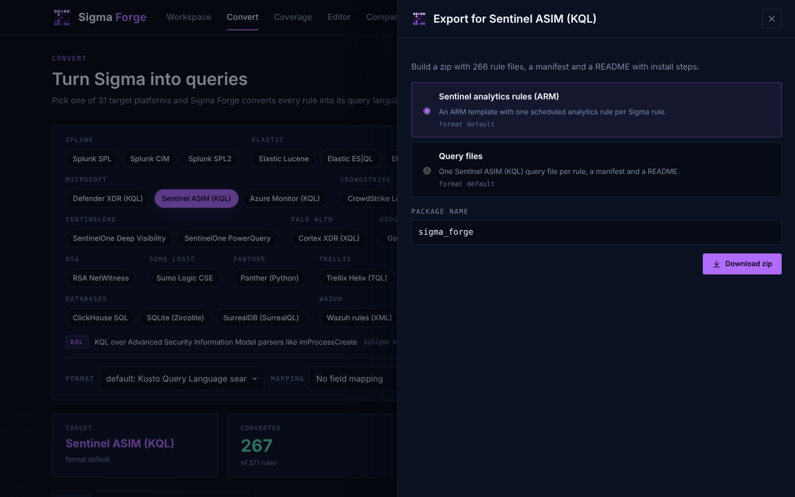<p align="center"><b>Export</b>: ready to deploy packages</p></td>
  </tr>
  <tr>
    <td width="50%">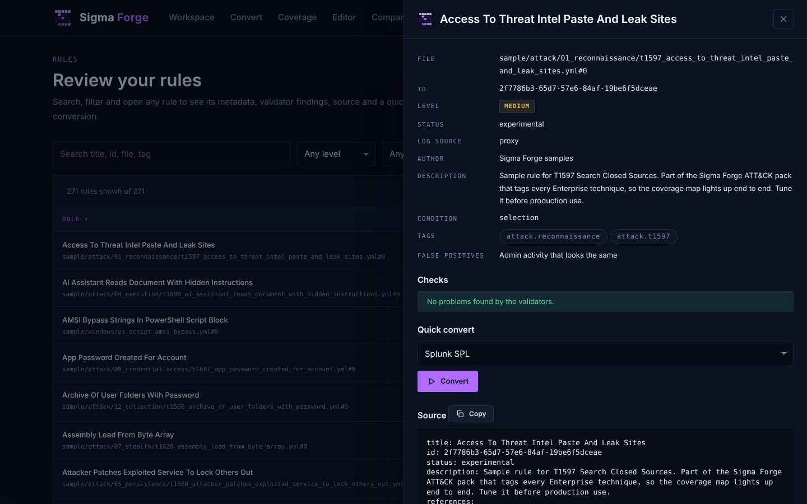<p align="center"><b>Rule detail</b>: convert any rule in one click</p></td>
    <td width="50%">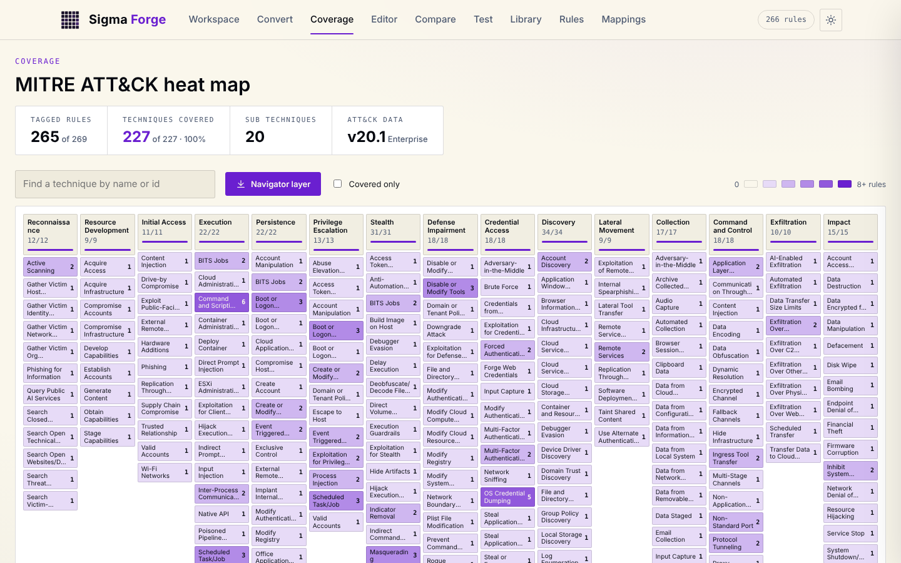<p align="center"><b>Light theme</b></p></td>
  </tr>
</table>

## Quick start

You need **Python 3.10 or newer**. Docker is optional.

### Linux and macOS

```bash
git clone https://github.com/qays3/Sigma-Forge.git
cd Sigma-Forge
chmod +x setup.sh
./setup.sh --run
```

### Windows (PowerShell)

```powershell
git clone https://github.com/qays3/Sigma-Forge.git
cd Sigma-Forge
Set-ExecutionPolicy -Scope Process -ExecutionPolicy Bypass
.\setup.ps1 -Run
```

### Docker

```bash
docker compose up -d --build
```

Then open **http://127.0.0.1:8000** and click **Load samples** to load the [sample pack](#sample-pack).

The setup scripts create a virtual environment in `.venv`, install the packages from `requirements.txt`, check the ATT&CK data and print the command to start the server. Run them again any time. They only change what is needed.

### Manual setup

If you prefer to do it by hand:

```bash
python3 -m venv .venv
source .venv/bin/activate          # Windows: .venv\Scripts\Activate.ps1
pip install -r requirements.txt
uvicorn app.main:app --host 127.0.0.1 --port 8000
```

## Setup script options

| `setup.sh` | `setup.ps1` | What it does |
|---|---|---|
| `--run` | `-Run` | Start the server after setup |
| `--dev` | `-Dev` | Install test tools and run the test suite |
| `--update-attack` | `-UpdateAttack` | Download the latest MITRE ATT&CK data |
| `--docker` | `-Docker` | Build and start with Docker Compose instead of a venv |
| `--recreate` | `-Recreate` | Delete and rebuild `.venv` |
| `--host HOST` | `-BindHost HOST` | Bind address (default `127.0.0.1`) |
| `--port PORT` | `-Port PORT` | Port (default `8000`) |
| `--help` | `-Help` | Show help |

Examples:

```bash
./setup.sh --dev                      # install, then run the tests
./setup.sh --update-attack --run      # refresh ATT&CK data and start
./setup.sh --host 0.0.0.0 --port 9000 --run
```

```powershell
.\setup.ps1 -Dev
.\setup.ps1 -UpdateAttack -Run
.\setup.ps1 -BindHost 0.0.0.0 -Port 9000 -Run
```

## How to use it

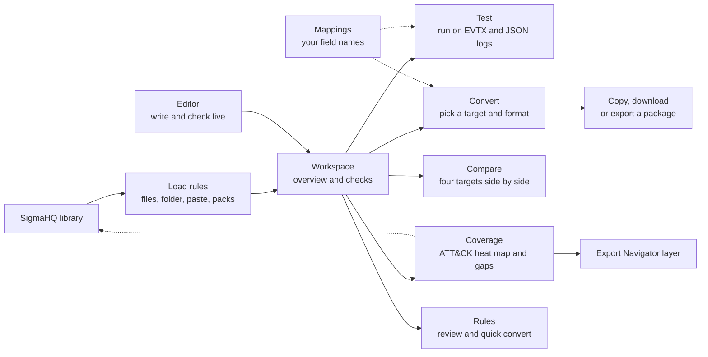

1. **Workspace.** Drop rule files or a folder on the drop zone, or click **Load samples** (and **Load error samples** to see how problems are reported). You see how many rules parsed, how many have errors or findings, and a breakdown by level and log source.
2. **Convert.** Pick a target on the left, choose an output format, select the rules, and press **Convert**. Each rule gets its own card with the query, any notes and a copy button. Tabs above the cards filter them by Converted, Skipped and Failed. **Download** saves all converted rules as one file.
3. **Coverage.** The heat map shows every ATT&CK Enterprise tactic and technique. Darker purple means more rules. Click a technique to see its sub techniques and the rules that cover it. Use **Covered only** to hide gaps, or keep them visible to find what to write next. **Navigator layer** downloads a JSON layer for [ATT&CK Navigator](https://mitre-attack.github.io/attack-navigator/).
4. **Rules.** Search and filter by level, status, product, tactic or check state. Click a row to open the detail drawer with metadata, validator findings, the rule source and a quick convert to any target.
5. **Editor.** Start from a template or open a workspace rule. Checks, the query for the chosen target and the ATT&CK tags refresh as you type. **Save to workspace** (or Ctrl+S) stores it. Your draft is kept in the browser between visits.
6. **Compare.** Pick one rule and up to four platforms to see their queries next to each other.
7. **Test.** Drop log files or click **Load sample logs**, choose how strictly log sources must match, and press **Run test**. Tabs split the rules into Fired, Silent, Errors and Skipped. **Details** shows the matching events, correlation alerts and the SQLite query that ran.
8. **Library.** Click **Sync now** to download the latest SigmaHQ release, then search and add rules. The Coverage page uses it to suggest rules for the techniques you miss.
9. **Mappings.** Make a profile of field renames, or start from a preset, and press **Save and use**. Convert, Compare and Test also let you pick a profile per run.
10. **Export.** On the Convert page, **Export package** builds a zip for the selected target with install steps.

## Sample pack

The [`sample`](sample) folder has rules, logs, test events and API requests that touch every feature. In the Workspace:

* **Load samples** loads 266 rule files: the 39 feature samples that show every modifier, log source and rule type, plus the ATT&CK pack with one rule for every ATT&CK Enterprise technique across all 15 tactics, so the heat map lights up end to end.
* **Load error samples** adds the six files in `sample/rules/broken`, which show how errors and findings look.

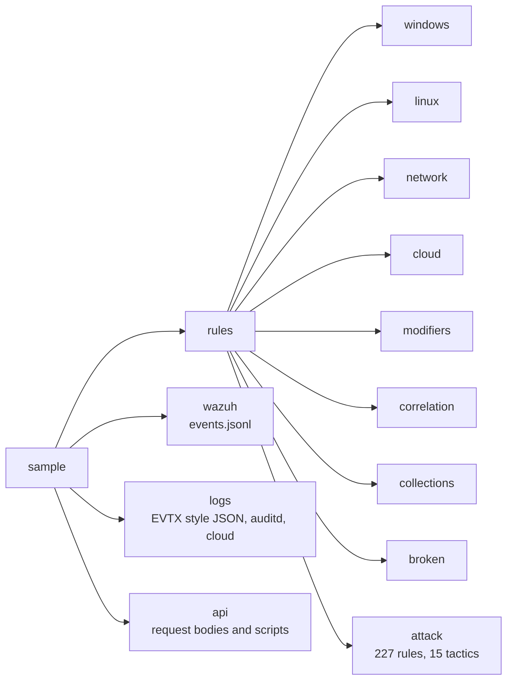

| Folder | What it shows |
|---|---|
| [`rules/windows`](sample/rules/windows) | 21 rules over Sysmon categories (process creation, network, image and driver load, remote thread, process access, pipes, WMI, files, registry, DNS) and Windows services (Security, System, PowerShell script and module logs, Defender). Levels from informational to critical. |
| [`rules/linux`](sample/rules/linux) | Process creation and auditd rules, including a keyword search. |
| [`rules/network`](sample/rules/network) | Proxy and firewall rules, with `cidr`. |
| [`rules/cloud`](sample/rules/cloud) | AWS CloudTrail and Azure sign in rules. Some pipelines do not map these, so you see clear per rule errors. |
| [`rules/modifiers`](sample/rules/modifiers) | One rule per group of modifiers: `contains`, `all`, `windash`, `re` with flags, `base64`, `wide` with `base64offset`, `cidr`, `exists`, `null`, `cased`, wildcards and keyword search. When a target cannot do one of them, Sigma Forge rewrites it to the closest thing the target can do and says so on the card. |
| [`rules/correlation`](sample/rules/correlation) | An `event_count` brute force rule and a `value_count` password spray rule. See [correlation rules](#correlation-rules) for the targets that convert them. |
| [`rules/collections`](sample/rules/collections) | A file with three rules, and an `action: global` file that shares one log source and selection between two rules. |
| [`rules/broken`](sample/rules/broken) | A YAML error, a missing detection, an unknown modifier, revoked and unknown ATT&CK tags, validator findings and a rule with no id or level. They show how errors and findings look. |
| [`rules/attack`](sample/rules/attack) | The ATT&CK pack: one folder per tactic (`01_reconnaissance` to `15_impact`) with one rule for each Enterprise technique. A technique that sits in several tactics is tagged with all of them and stored under the first. The rules use Windows, Linux, macOS, cloud (AWS, Azure, Microsoft 365, GCP), Kubernetes, ESXi, proxy, web server and firewall log sources. They are samples to learn from, so tune them before production use. |
| [`logs`](sample/logs) | Six log files for the Test page: Sysmon and Security events in the same JSON layout the EVTX parser makes (both `EventData` styles), PowerShell and Defender events, Linux auditd and process events, firewall and proxy events, and AWS CloudTrail plus Azure sign in records. Every feature sample rule fires on them, and the failed logon bursts trigger both correlation rules. |
| [`wazuh/events.jsonl`](sample/wazuh/events.jsonl) | Test events for the Wazuh target's `wazuh_check.py` tool. |
| [`api`](sample/api) | Ready request bodies for every endpoint, plus `run_examples.sh` and `run_examples.ps1` that call them and save the answers in `sample/api/output`. |

Try the API samples while the server runs:

```bash
./sample/api/run_examples.sh                  # Linux and macOS
```

```powershell
.\sample\api\run_examples.ps1                # Windows
```

## Supported targets

Sigma Forge converts to **31 targets** across 19 platforms. Each one runs on a pySigma backend or on a backend that ships with Sigma Forge.

| Target | Language | Formats | Sample pack | Correlations |
|---|---|---|---|---|
| [Splunk SPL](#splunk) | spl | `default`, `savedsearches` | 42 of 44 | yes |
| [Splunk CIM](#splunk-cim) | spl | `default`, `savedsearches`, `data_model` | 40 of 44 | no |
| [Splunk SPL2](#splunk-spl2) | spl2 | `default`, `module` | 40 of 44 | no |
| [Elastic Lucene](#elastic-lucene) | lucene | `default`, `kibana_ndjson`, `dsl_lucene`, `siem_rule`, `siem_rule_ndjson` | 40 of 44 | no |
| [Elastic ES\|QL](#elastic-esql) | esql | `default`, `kibana_ndjson`, `siem_rule`, `siem_rule_ndjson` | 42 of 44 | yes |
| [Elastic EQL](#elastic-eql) | eql | `default`, `eqlapi`, `siem_rule`, `siem_rule_ndjson` | 42 of 44 | yes |
| [ElastAlert](#elastalert) | yaml | `default` | 42 of 44 | yes |
| [OpenSearch Lucene](#opensearch-lucene) | lucene | `default`, `dashboards_ndjson`, `monitor_rule`, `dsl_lucene` | 40 of 44 | no |
| [OpenSearch PPL](#opensearch-ppl) | ppl | `default` | 42 of 44 | yes |
| [Defender XDR (KQL)](#defender-xdr) | kql | `default` | 40 of 44 | no |
| [Sentinel ASIM (KQL)](#sentinel-asim) | kql | `default` | 40 of 44 | no |
| [Azure Monitor (KQL)](#azure-monitor) | kql | `default` | 40 of 44 | no |
| [CrowdStrike LogScale (Falcon)](#crowdstrike-falcon) | logscale | `default` | 40 of 44 | no |
| [CrowdStrike LogScale (FDR)](#crowdstrike-fdr) | logscale | `default` | 40 of 44 | no |
| [SentinelOne Deep Visibility](#sentinelone) | s1ql | `default`, `json` | 40 of 44 | no |
| [SentinelOne PowerQuery](#sentinelone-pq) | powerquery | `default`, `json` | 40 of 44 | no |
| [Cortex XDR (XQL)](#cortex-xdr) | xql | `default`, `json` | 40 of 44 | no |
| [Google SecOps (UDM)](#secops) | udm | `default`, `yara_l` | 40 of 44 | no |
| [Carbon Black Cloud](#carbon-black) | cbc | `default`, `json` | 40 of 44 | no |
| [IBM QRadar AQL](#qradar) | aql | `default` | 32 of 44 | no |
| [Logpoint](#logpoint) | lpql | `default` | 40 of 44 | no |
| [RSA NetWitness](#netwitness) | netwitness | `default` | 40 of 44 | no |
| [Sumo Logic CSE](#sumologic-cse) | json | `default`, `cse_rule` | 40 of 44 | no |
| [Panther (Python)](#panther) | python | `default`, `sdyaml`, `python`, `pantherflow` | 42 of 44 | no |
| [Trellix Helix (TQL)](#trellix-helix) | tql | `default` | 40 of 44 | no |
| [Grafana Loki (LogQL)](#loki) | logql | `default`, `ruler`, `grafana_alerting` | 42 of 44 | yes |
| [Quickwit](#quickwit) | quickwit | `default` | 40 of 44 | no |
| [ClickHouse SQL](#clickhouse) | sql | `default`, `clickdetect` | 42 of 44 | yes |
| [SQLite (Zircolite)](#sqlite) | sql | `default`, `zircolite` | 42 of 44 | yes |
| [SurrealDB (SurrealQL)](#surrealql) | surrealql | `default` | 39 of 44 | no |
| [Wazuh rules (XML)](#wazuh) | xml | `default` | 43 of 44 | yes |

Three backends (IBM QRadar, Trellix Helix and SurrealQL) were built for older pySigma versions. They still convert with pySigma 1.5, so the setup scripts install them from `requirements-legacy.txt` without their old version pins. A few other community backends (Datadog, InsightIDR, QRadar AQL and uberAgent) cannot load on pySigma 1.x and are left out.

To add another target, `pip install` its pySigma backend and add one `Target(...)` line to [`app/core/targets.py`](app/core/targets.py).

## Target guide

Every target below was tested with the working rules of the [sample pack](#sample-pack). "Sample pack" shows how many converted. Rules fail when a platform has no field for them or cannot do a feature (for example `fieldref` or case sensitive matching), and the card in the app tells you why.

### Splunk

<details id="splunk">
<summary><b>Splunk SPL</b>: Splunk Search Processing Language for Windows Event Log and Sysmon data</summary>

| | |
|---|---|
| Target id | `splunk` |
| Engine | pySigma backend `splunk` |
| Pipelines | `sysmon`, `splunk_windows` |
| Formats | `default`, `savedsearches` |
| Sample pack | 42 of 44 converted, 2 skipped |
| Correlations | supported |
| Most common failures | none |

**Tips:** Paste the query in Search, or pick the savedsearches format to get a savedsearches.conf stanza.

Example for `windows/proc_creation_whoami_recon.yml`:

```spl
source="WinEventLog:Microsoft-Windows-Sysmon/Operational" EventCode=1 Image="*\\whoami.exe" OR OriginalFileName="whoami.exe" CommandLine="* -priv*" OR CommandLine="* /priv*" OR CommandLine="* –priv*" OR CommandLine="* —priv*" OR CommandLine="* ―priv*" OR CommandLine="* -groups*" OR CommandLine="* /groups*" OR CommandLine="* –groups*" OR CommandLine="* —groups*" OR CommandLine="* ―groups*" OR CommandLine="* -all*" OR ...
```

</details>

<details id="splunk-cim">
<summary><b>Splunk CIM</b>: tstats searches over the Common Information Model data models</summary>

| | |
|---|---|
| Target id | `splunk_cim` |
| Engine | pySigma backend `splunk` |
| Pipelines | `splunk_cim` |
| Formats | `default`, `savedsearches`, `data_model` |
| Sample pack | 40 of 44 converted, 0 skipped |
| Correlations | not supported |
| Most common failures | Rule type not yet supported by the Splunk data model CIM pipeline! (4) |

**Tips:** Use the data_model format. Needs accelerated CIM data models such as Endpoint.Processes.

Example for `windows/proc_creation_whoami_recon.yml`:

```spl
| tstats summariesonly=false allow_old_summaries=true fillnull_value="null" count min(_time) as firstTime max(_time) as lastTime from datamodel=Endpoint.Processes where Processes.process_path="*\\whoami.exe" OR Processes.original_file_name="whoami.exe" Processes.process="* -priv*" OR Processes.process="* /priv*" OR Processes.process="* –priv*" OR Processes.process="* —priv*" OR Processes.process="* ―priv*" OR Process ...
```

</details>

<details id="splunk-spl2">
<summary><b>Splunk SPL2</b>: Next generation SPL2 syntax for Splunk Cloud and Edge Processor</summary>

| | |
|---|---|
| Target id | `splunk_spl2` |
| Engine | pySigma backend `splunk_spl2` |
| Pipelines | `sysmon`, `splunk_windows` |
| Formats | `default`, `module` |
| Sample pack | 40 of 44 converted, 2 skipped |
| Correlations | not supported |
| Most common failures | Splunk SPL2 cannot convert correlation rules. Splunk SPL, Elastic ES\|QL, EQL, ElastAlert, OpenSearch PPL, Graf (2) |

**Tips:** SPL2 starts with FROM main. Change the index name to yours.

Example for `windows/proc_creation_whoami_recon.yml`:

```sql
FROM main WHERE source="WinEventLog:Microsoft-Windows-Sysmon/Operational" AND EventCode=1 AND Image LIKE "%\whoami.exe" OR OriginalFileName="whoami.exe" AND CommandLine LIKE "% -priv%" OR CommandLine LIKE "% /priv%" OR CommandLine LIKE "% –priv%" OR CommandLine LIKE "% —priv%" OR CommandLine LIKE "% ―priv%" OR CommandLine LIKE "% -groups%" OR CommandLine LIKE "% /groups%" OR CommandLine LIKE "% –groups%" OR CommandLi ...
```

</details>

### Elastic

<details id="elastic-lucene">
<summary><b>Elastic Lucene</b>: Kibana query bar and detection rules with Elastic Common Schema (ECS) fields</summary>

| | |
|---|---|
| Target id | `elastic_lucene` |
| Engine | pySigma backend `lucene` |
| Pipelines | `ecs_windows` |
| Formats | `default`, `kibana_ndjson`, `dsl_lucene`, `siem_rule`, `siem_rule_ndjson` |
| Sample pack | 40 of 44 converted, 2 skipped |
| Correlations | not supported |
| Most common failures | Elastic Lucene cannot convert correlation rules. Splunk SPL, Elastic ES\|QL, EQL, ElastAlert, OpenSearch PPL, G (2) |

**Tips:** Pick siem_rule_ndjson to import straight into Elastic Security rules.

Example for `windows/proc_creation_whoami_recon.yml`:

```text
(process.executable.caseless:*\\whoami.exe OR process.pe.original_file_name:whoami.exe) AND (process.command_line:(*\ \-priv* OR *\ \/priv* OR *\ –priv* OR *\ —priv* OR *\ ―priv*) OR process.command_line:(*\ \-groups* OR *\ \/groups* OR *\ –groups* OR *\ —groups* OR *\ ―groups*) OR process.command_line:(*\ \-all* OR *\ \/all* OR *\ –all* OR *\ —all* OR *\ ―all*))
```

</details>

<details id="elastic-esql">
<summary><b>Elastic ES|QL</b>: Elasticsearch Query Language with ECS fields, supports correlations</summary>

| | |
|---|---|
| Target id | `elastic_esql` |
| Engine | pySigma backend `esql` |
| Pipelines | `ecs_windows` |
| Formats | `default`, `kibana_ndjson`, `siem_rule`, `siem_rule_ndjson` |
| Sample pack | 42 of 44 converted, 2 skipped |
| Correlations | supported |
| Most common failures | none |

**Tips:** Replace 'from *' with your index pattern, for example logs-*.

Example for `windows/proc_creation_whoami_recon.yml`:

```sql
from * metadata _id, _index, _version | where (ends_with(process.executable.caseless, "\\whoami.exe") or process.pe.original_file_name=="whoami.exe") and (process.command_line like "* -priv*" or process.command_line like "* /priv*" or process.command_line like "* –priv*" or process.command_line like "* —priv*" or process.command_line like "* ―priv*" or process.command_line like "* -groups*" or process.command_line li ...
```

</details>

<details id="elastic-eql">
<summary><b>Elastic EQL</b>: Event Query Language with ECS fields</summary>

| | |
|---|---|
| Target id | `elastic_eql` |
| Engine | pySigma backend `eql` |
| Pipelines | `ecs_windows` |
| Formats | `default`, `eqlapi`, `siem_rule`, `siem_rule_ndjson` |
| Sample pack | 42 of 44 converted, 2 skipped |
| Correlations | supported |
| Most common failures | none |


Example for `windows/proc_creation_whoami_recon.yml`:

```sql
any where (process.executable.caseless:"*\\whoami.exe" or process.pe.original_file_name:"whoami.exe") and (process.command_line like~ ("* -priv*", "* /priv*", "* –priv*", "* —priv*", "* ―priv*") or process.command_line like~ ("* -groups*", "* /groups*", "* –groups*", "* —groups*", "* ―groups*") or process.command_line like~ ("* -all*", "* /all*", "* –all*", "* —all*", "* ―all*"))
```

</details>

<details id="elastalert">
<summary><b>ElastAlert</b>: ElastAlert 2 rule files with ECS fields</summary>

| | |
|---|---|
| Target id | `elastalert` |
| Engine | pySigma backend `elastalert` |
| Pipelines | `ecs_windows` |
| Formats | `default` |
| Sample pack | 42 of 44 converted, 2 skipped |
| Correlations | supported |
| Most common failures | none |

**Tips:** Add index, alert and other required keys to each rule before loading it in ElastAlert 2.

Example for `windows/proc_creation_whoami_recon.yml`:

```yaml
description: Detects whoami used to list privileges or groups, often run right after
  initial access.
filter:
- query:
    query_string:
      query: "(process.executable.caseless:*\\\\whoami.exe OR process.pe.original_file_name:whoami.exe)
        AND (process.command_line:(*\\ \\-priv* OR *\\ \\/priv* OR *\\ \u2013priv*
        OR *\\ \u2014priv* OR *\\ \u2015priv*) OR process.command_line:(*\\ \\-groups* ...
```

</details>

### OpenSearch

<details id="opensearch-lucene">
<summary><b>OpenSearch Lucene</b>: OpenSearch Dashboards queries and monitor rules with ECS fields</summary>

| | |
|---|---|
| Target id | `opensearch_lucene` |
| Engine | pySigma backend `opensearch_lucene` |
| Pipelines | `ecs_windows` |
| Formats | `default`, `dashboards_ndjson`, `monitor_rule`, `dsl_lucene` |
| Sample pack | 40 of 44 converted, 2 skipped |
| Correlations | not supported |
| Most common failures | OpenSearch Lucene cannot convert correlation rules. Splunk SPL, Elastic ES\|QL, EQL, ElastAlert, OpenSearch PPL (2) |

**Tips:** Pick monitor_rule to get OpenSearch Alerting monitors.

Example for `windows/proc_creation_whoami_recon.yml`:

```text
(process.executable.caseless:*\\whoami.exe OR process.pe.original_file_name:whoami.exe) AND (process.command_line:(*\ \-priv* OR *\ \/priv* OR *\ –priv* OR *\ —priv* OR *\ ―priv*) OR process.command_line:(*\ \-groups* OR *\ \/groups* OR *\ –groups* OR *\ —groups* OR *\ ―groups*) OR process.command_line:(*\ \-all* OR *\ \/all* OR *\ –all* OR *\ —all* OR *\ ―all*))
```

</details>

<details id="opensearch-ppl">
<summary><b>OpenSearch PPL</b>: OpenSearch Piped Processing Language</summary>

| | |
|---|---|
| Target id | `opensearch_ppl` |
| Engine | pySigma backend `open_search_ppl` |
| Pipelines | built in to the backend |
| Formats | `default` |
| Sample pack | 42 of 44 converted, 2 skipped |
| Correlations | supported |
| Most common failures | none |

**Tips:** The source index is named after the log source, like windows-process_creation-*. Change it to your index.

Example for `windows/proc_creation_whoami_recon.yml`:

```sql
source=windows-process_creation-* | where (LIKE(Image, "%whoami.exe") OR OriginalFileName="whoami.exe") AND (LIKE(CommandLine, "% -priv%") OR LIKE(CommandLine, "% /priv%") OR LIKE(CommandLine, "% –priv%") OR LIKE(CommandLine, "% —priv%") OR LIKE(CommandLine, "% ―priv%") OR LIKE(CommandLine, "% -groups%") OR LIKE(CommandLine, "% /groups%") OR LIKE(CommandLine, "% –groups%") OR LIKE(CommandLine, "% —groups%") OR LIKE(C ...
```

</details>

### Microsoft

<details id="defender-xdr">
<summary><b>Defender XDR (KQL)</b>: Kusto Query Language (KQL) for advanced hunting tables like DeviceProcessEvents</summary>

| | |
|---|---|
| Target id | `defender_xdr` |
| Engine | pySigma backend `kusto` |
| Pipelines | `microsoft_xdr` |
| Formats | `default` |
| Sample pack | 40 of 44 converted, 2 skipped |
| Correlations | not supported |
| Most common failures | Unable to determine table name from rule.  The query table is determined in the following order of priority:
  (16); Backend does not support correlation rules. (2); Case-sensitive string matching is not supported by backend. (1) |


Example for `windows/proc_creation_whoami_recon.yml`:

```kql
DeviceProcessEvents
| where (FolderPath endswith "\\whoami.exe" or ProcessVersionInfoOriginalFileName =~ "whoami.exe") and (ProcessCommandLine contains " -priv" or ProcessCommandLine contains " /priv" or ProcessCommandLine contains " –priv" or ProcessCommandLine contains " —priv" or ProcessCommandLine contains " ―priv" or ProcessCommandLine contains " -groups" or ProcessCommandLine contains " /groups" or ProcessComma ...
```

</details>

<details id="sentinel-asim">
<summary><b>Sentinel ASIM (KQL)</b>: KQL over Advanced Security Information Model parsers like imProcessCreate</summary>

| | |
|---|---|
| Target id | `sentinel_asim` |
| Engine | pySigma backend `kusto` |
| Pipelines | `sentinel_asim` |
| Formats | `default` |
| Sample pack | 40 of 44 converted, 2 skipped |
| Correlations | not supported |
| Most common failures | Unable to determine table name from rule.  The query table is determined in the following order of priority:
  (16); Backend does not support correlation rules. (2); Invalid SigmaDetectionItem field name encountered: TargetProcessFilename. Invalid SigmaDetectionItem field nam (2) |


Example for `windows/proc_creation_whoami_recon.yml`:

```kql
ERROR Invalid SigmaDetectionItem field name encountered: TargetProcessFilename. Please use valid fields for the imProcessCreate table, or the following fields that have fieldmappings in this pipeline:
ActingProcessCommandLine, ActingProcessCreationTime, ActingProcessFileCompany, ActingProcessFileDescription, ActingProcessFileInternalName, ActingProcessFileOriginalName, ActingProcessFileProduct, ActingProcessFileSize, ...
```

</details>

<details id="azure-monitor">
<summary><b>Azure Monitor (KQL)</b>: KQL for Log Analytics tables like SecurityEvent</summary>

| | |
|---|---|
| Target id | `azure_monitor` |
| Engine | pySigma backend `kusto` |
| Pipelines | `azure_monitor` |
| Formats | `default` |
| Sample pack | 40 of 44 converted, 2 skipped |
| Correlations | not supported |
| Most common failures | Unable to determine table name from rule.  The query table is determined in the following order of priority:
  (16); Backend does not support correlation rules. (2); Invalid SigmaDetectionItem field name encountered: OriginalFileName. Invalid SigmaDetectionItem field name enc (2) |


Example for `windows/proc_creation_whoami_recon.yml`:

```kql
ERROR Invalid SigmaDetectionItem field name encountered: OriginalFileName. Please use valid fields for the SecurityEvent table, or the following fields that have fieldmappings in this pipeline:
AccessList, AccessMask, Account, AccountDomain, AccountExpires, AccountName, AccountSessionIdentifier, AccountType, Activity, AdditionalInfo, AdditionalInfo2, AllowedToDelegateTo, Attributes, AuditPolicyChanges, AuditsDiscarde ...
```

</details>

### CrowdStrike

<details id="crowdstrike-falcon">
<summary><b>CrowdStrike LogScale (Falcon)</b>: Falcon LogScale (Humio) queries over Falcon sensor events like ProcessRollup2</summary>

| | |
|---|---|
| Target id | `crowdstrike_falcon` |
| Engine | pySigma backend `log_scale` |
| Pipelines | `crowdstrike_falcon` |
| Formats | `default` |
| Sample pack | 40 of 44 converted, 2 skipped |
| Correlations | not supported |
| Most common failures | CrowdStrike LogScale (Falcon) cannot convert correlation rules. Splunk SPL, Elastic ES\|QL, EQL, ElastAlert, Op (2) |

**Tips:** Run it in Falcon Next-Gen SIEM or Event Search. CIDR lists joined with OR are not supported yet.

Example for `windows/proc_creation_whoami_recon.yml`:

```text
event_platform=/^Win$/i #event_simpleName=/^ProcessRollup2$/i or #event_simpleName=/^SyntheticProcessRollup2$/i ImageFileName=/\\whoami\.exe$/i or OriginalFilename=/^whoami\.exe$/i CommandLine=/ -priv/i or CommandLine=/ \/priv/i or CommandLine=/ –priv/i or CommandLine=/ —priv/i or CommandLine=/ ―priv/i or CommandLine=/ -groups/i or CommandLine=/ \/groups/i or CommandLine=/ –groups/i or CommandLine=/ —groups/i or Comm ...
```

</details>

<details id="crowdstrike-fdr">
<summary><b>CrowdStrike LogScale (FDR)</b>: LogScale queries over Falcon Data Replicator field names</summary>

| | |
|---|---|
| Target id | `crowdstrike_fdr` |
| Engine | pySigma backend `log_scale` |
| Pipelines | `crowdstrike_fdr` |
| Formats | `default` |
| Sample pack | 40 of 44 converted, 2 skipped |
| Correlations | not supported |
| Most common failures | CrowdStrike LogScale (FDR) cannot convert correlation rules. Splunk SPL, Elastic ES\|QL, EQL, ElastAlert, OpenS (2) |


Example for `windows/proc_creation_whoami_recon.yml`:

```text
event_platform=/^Win$/i event_simpleName=/^ProcessRollup2$/i or event_simpleName=/^SyntheticProcessRollup2$/i ImageFileName=/\\whoami\.exe$/i or OriginalFilename=/^whoami\.exe$/i CommandLine=/ -priv/i or CommandLine=/ \/priv/i or CommandLine=/ –priv/i or CommandLine=/ —priv/i or CommandLine=/ ―priv/i or CommandLine=/ -groups/i or CommandLine=/ \/groups/i or CommandLine=/ –groups/i or CommandLine=/ —groups/i or Comman ...
```

</details>

### SentinelOne

<details id="sentinelone">
<summary><b>SentinelOne Deep Visibility</b>: SentinelOne Deep Visibility queries (S1QL)</summary>

| | |
|---|---|
| Target id | `sentinelone` |
| Engine | pySigma backend `sentinel_one` |
| Pipelines | built in to the backend |
| Formats | `default`, `json` |
| Sample pack | 40 of 44 converted, 0 skipped |
| Correlations | not supported |
| Most common failures | Invalid SigmaDetectionItem field name encountered: EventID. Invalid SigmaDetectionItem field name encountered: (4) |

**Tips:** Only Windows, Linux and macOS endpoint log sources are mapped.

Example for `windows/proc_creation_whoami_recon.yml`:

```text
ERROR Invalid SigmaDetectionItem field name encountered: OriginalFileName. Invalid SigmaDetectionItem field name encountered: EventID. Invalid SigmaDetectionItem field name encountered: Provider_Name. Invalid SigmaDetectionItem field name encountered: EventID. Invalid SigmaDetectionItem field name encountered: EventID. Invalid SigmaDetectionItem field name encountered: ScriptBlockText. Invalid SigmaDetectionItem fiel ...
```

</details>

<details id="sentinelone-pq">
<summary><b>SentinelOne PowerQuery</b>: SentinelOne Singularity Data Lake PowerQuery</summary>

| | |
|---|---|
| Target id | `sentinelone_pq` |
| Engine | pySigma backend `sentinel_one_pq` |
| Pipelines | built in to the backend |
| Formats | `default`, `json` |
| Sample pack | 40 of 44 converted, 0 skipped |
| Correlations | not supported |
| Most common failures | Invalid SigmaDetectionItem field name encountered: EventID. Invalid SigmaDetectionItem field name encountered: (4) |


Example for `windows/proc_creation_whoami_recon.yml`:

```text
ERROR Invalid SigmaDetectionItem field name encountered: OriginalFileName. Invalid SigmaDetectionItem field name encountered: EventID. Invalid SigmaDetectionItem field name encountered: Provider_Name. Invalid SigmaDetectionItem field name encountered: EventID. Invalid SigmaDetectionItem field name encountered: EventID. Invalid SigmaDetectionItem field name encountered: ScriptBlockText. Invalid SigmaDetectionItem fiel ...
```

</details>

### Palo Alto

<details id="cortex-xdr">
<summary><b>Cortex XDR (XQL)</b>: Palo Alto Networks Cortex XDR Query Language over xdr_data</summary>

| | |
|---|---|
| Target id | `cortex_xdr` |
| Engine | pySigma backend `cortex_xdr` |
| Pipelines | built in to the backend |
| Formats | `default`, `json` |
| Sample pack | 40 of 44 converted, 0 skipped |
| Correlations | not supported |
| Most common failures | Rule type not yet supported by the Cortex XDR Sigma backend (4) |

**Tips:** Only endpoint log sources are mapped. Network and cloud rules show an error.

Example for `windows/proc_creation_whoami_recon.yml`:

```text
ERROR Invalid SigmaDetectionItem field name encountered: OriginalFileName. Invalid SigmaDetectionItem field name encountered: OriginalFileName. Invalid SigmaDetectionItem field name encountered: OriginalFileName. Invalid SigmaDetectionItem field name encountered: None. Invalid SigmaDetectionItem field name encountered: OriginalFileName. This pipeline only supports the following fields for process activity:
{User}, {C ...
```

</details>

### Google

<details id="secops">
<summary><b>Google SecOps (UDM)</b>: Google Security Operations (Chronicle) Unified Data Model search</summary>

| | |
|---|---|
| Target id | `secops` |
| Engine | pySigma backend `secops` |
| Pipelines | `secops_udm` |
| Formats | `default`, `yara_l` |
| Sample pack | 40 of 44 converted, 2 skipped |
| Correlations | not supported |
| Most common failures | Google SecOps (UDM) cannot convert correlation rules. Splunk SPL, Elastic ES\|QL, EQL, ElastAlert, OpenSearch P (2) |

**Tips:** Pick the yara_l format to get YARA-L 2.0 detection rules.

Example for `windows/proc_creation_whoami_recon.yml`:

```text
(metadata.event_type = "PROCESS_LAUNCH") AND ((target.process.file.full_path = /\\whoami\.exe$/ nocase OR target.process.file.names = "whoami.exe" nocase) AND (target.process.command_line = / -priv/ nocase OR target.process.command_line = / \/priv/ nocase OR target.process.command_line = / –priv/ nocase OR target.process.command_line = / —priv/ nocase OR target.process.command_line = / ―priv/ nocase OR target.process ...
```

</details>

### Broadcom

<details id="carbon-black">
<summary><b>Carbon Black Cloud</b>: Carbon Black Cloud Enterprise EDR process search</summary>

| | |
|---|---|
| Target id | `carbon_black` |
| Engine | pySigma backend `carbon_black` |
| Pipelines | `carbonblack` |
| Formats | `default`, `json` |
| Sample pack | 40 of 44 converted, 0 skipped |
| Correlations | not supported |
| Most common failures | Invalid SigmaDetectionItem field name encountered: EventID. Invalid SigmaDetectionItem field name encountered: (2); Invalid SigmaDetectionItem field name encountered: EventID. The supported fields are: {CommandLine}, {Company} (2) |


Example for `windows/proc_creation_whoami_recon.yml`:

```text
device_os:WINDOWS ((process_name:\\whoami.exe OR process_original_filename:whoami.exe) (process_cmdline:\ \-priv* OR process_cmdline:\ \/priv* OR process_cmdline:\ –priv* OR process_cmdline:\ —priv* OR process_cmdline:\ ―priv* OR process_cmdline:\ \-groups* OR process_cmdline:\ \/groups* OR process_cmdline:\ –groups* OR process_cmdline:\ —groups* OR process_cmdline:\ ―groups* OR process_cmdline:\ \-all* OR process_cm ...
```

</details>

### IBM

<details id="qradar">
<summary><b>IBM QRadar AQL</b>: Ariel Query Language (AQL) searches for QRadar</summary>

| | |
|---|---|
| Target id | `qradar` |
| Engine | pySigma backend `qradar` |
| Pipelines | built in to the backend |
| Formats | `default` |
| Sample pack | 32 of 44 converted, 2 skipped |
| Correlations | not supported |
| Most common failures | The QRadar savedsearches Sigma backend supports only the following fields for process_creation log source (8); IBM QRadar AQL cannot convert correlation rules. Splunk SPL, Elastic ES\|QL, EQL, ElastAlert, OpenSearch PPL, G (2) |

**Tips:** Uses the legacy QRadar backend (installed from requirements-legacy.txt). Field names follow QRadar default properties.

Example for `windows/proc_creation_whoami_recon.yml`:

```sql
SELECT UTF8(payload) as search_payload from events where ("Image" ILIKE '%\whoami.exe' OR "ImageName"='whoami.exe') AND ("Process CommandLine" ILIKE '% -priv%' OR "Process CommandLine" ILIKE '% /priv%' OR "Process CommandLine" ILIKE '% –priv%' OR "Process CommandLine" ILIKE '% —priv%' OR "Process CommandLine" ILIKE '% ―priv%' OR "Process CommandLine" ILIKE '% -groups%' OR "Process CommandLine" ILIKE '% /groups%' OR " ...
```

</details>

### Logpoint

<details id="logpoint">
<summary><b>Logpoint</b>: Logpoint Query Language with Logpoint Windows taxonomy</summary>

| | |
|---|---|
| Target id | `logpoint` |
| Engine | pySigma backend `logpoint` |
| Pipelines | `logpoint_windows` |
| Formats | `default` |
| Sample pack | 40 of 44 converted, 2 skipped |
| Correlations | not supported |
| Most common failures | Logpoint cannot convert correlation rules. Splunk SPL, Elastic ES\|QL, EQL, ElastAlert, OpenSearch PPL, Grafana (2) |


Example for `windows/proc_creation_whoami_recon.yml`:

```text
label="Create" label="Process" "process"="*\whoami.exe" OR file="whoami.exe" command="* -priv*" OR command="* /priv*" OR command="* –priv*" OR command="* —priv*" OR command="* ―priv*" OR command="* -groups*" OR command="* /groups*" OR command="* –groups*" OR command="* —groups*" OR command="* ―groups*" OR command="* -all*" OR command="* /all*" OR command="* –all*" OR command="* —all*" OR command="* ―all*"
```

</details>

### RSA

<details id="netwitness">
<summary><b>RSA NetWitness</b>: NetWitness query syntax for Windows log sources</summary>

| | |
|---|---|
| Target id | `netwitness` |
| Engine | pySigma backend `net_witness` |
| Pipelines | `netwitness_windows` |
| Formats | `default` |
| Sample pack | 40 of 44 converted, 2 skipped |
| Correlations | not supported |
| Most common failures | RSA NetWitness cannot convert correlation rules. Splunk SPL, Elastic ES\|QL, EQL, ElastAlert, OpenSearch PPL, G (2) |


Example for `windows/proc_creation_whoami_recon.yml`:

```text
device.type = 'windows' && (reference.id = '4688' && ((process ends '\whoami.exe' || OriginalFileName = 'whoami.exe') && (param contains ' -priv',' /priv',' –priv',' —priv',' ―priv',' -groups',' /groups',' –groups',' —groups',' ―groups',' -all',' /all',' –all',' —all',' ―all')))
```

</details>

### Sumo Logic

<details id="sumologic-cse">
<summary><b>Sumo Logic CSE</b>: Sumo Logic Cloud SIEM rule JSON</summary>

| | |
|---|---|
| Target id | `sumologic_cse` |
| Engine | pySigma backend `sumologic_cse` |
| Pipelines | `sumologic_cse` |
| Formats | `default`, `cse_rule` |
| Sample pack | 40 of 44 converted, 2 skipped |
| Correlations | not supported |
| Most common failures | Backend does not support correlation rules. (2); Conversion failed: Unbound value expressions (keywords) are not supported.

Unsupported Sigma pattern:
  detec (1); Case-sensitive string matching is not supported by backend. (1) |

**Tips:** Import the JSON with the Cloud SIEM API. Keyword only rules are not supported.

Example for `windows/proc_creation_whoami_recon.yml`:

```json
{
    "content_type": "RULE",
    "enabled": true,
    "is_prototype": false,
    "name": "Whoami With Privilege Or Group Flags",
    "name_expression": "Whoami With Privilege Or Group Flags",
    "rule_source": "user",
    "summary_expression": "",
    "pattern_type": "templated_match",
    "stream": "record",
    "description_expression": "Detects whoami used to list privileges or groups, often run right after init ...
```

</details>

### Panther

<details id="panther">
<summary><b>Panther (Python)</b>: Panther detections as Python rule functions</summary>

| | |
|---|---|
| Target id | `panther` |
| Engine | pySigma backend `panther` |
| Pipelines | built in to the backend |
| Formats | `default`, `sdyaml`, `python`, `pantherflow` |
| Sample pack | 42 of 44 converted, 0 skipped |
| Correlations | not supported |
| Most common failures | Panther (Python) cannot convert correlation rules. Splunk SPL, Elastic ES\|QL, EQL, ElastAlert, OpenSearch PPL, (2) |

**Tips:** Pick sdyaml for Panther simple detections or pantherflow for PantherFlow queries.

Example for `windows/proc_creation_whoami_recon.yml`:

```python
def rule(event):
    if all(
        [
            any(
                [
                    event.deep_get("Image", default="").endswith("\\whoami.exe"),
                    event.deep_get("OriginalFileName", default="") == "whoami.exe",
                ]
            ),
            any(
                [
                    any(
                        [
                            " -priv" in event.deep_get("Comma ...
```

</details>

### Trellix

<details id="trellix-helix">
<summary><b>Trellix Helix (TQL)</b>: Trellix Helix Query Language</summary>

| | |
|---|---|
| Target id | `trellix_helix` |
| Engine | pySigma backend `tql` |
| Pipelines | built in to the backend |
| Formats | `default` |
| Sample pack | 40 of 44 converted, 0 skipped |
| Correlations | not supported |
| Most common failures | Rule type not yet supported by the Helix Sigma backend (6); Invalid fieldname encounter: eventSource.This pipeline only supports the following fields:
{AccountDomain}, {A (1); Invalid fieldname encounter: ResultType.Invalid fieldname encounter: eventSource.This pipeline only supports t (1) |

**Tips:** Uses a legacy backend (requirements-legacy.txt). Only a set of Helix fields is mapped.

Example for `windows/proc_creation_whoami_recon.yml`:

```text
(category : ["process create (rule: processcreate)","process creation"]) AND (metaclass:"windows" AND ((process:"*\\whoami.exe" OR original_file_name:"whoami.exe") AND (args : " -priv" OR args : " /priv" OR args : " –priv" OR args : " —priv" OR args : " ―priv" OR args : " -groups" OR args : " /groups" OR args : " –groups" OR args : " —groups" OR args : " ―groups" OR args : " -all" OR args : " /all" OR args : " –all" ...
```

</details>

### Grafana

<details id="loki">
<summary><b>Grafana Loki (LogQL)</b>: LogQL queries for Grafana Loki</summary>

| | |
|---|---|
| Target id | `loki` |
| Engine | pySigma backend `loki` |
| Pipelines | built in to the backend |
| Formats | `default`, `ruler`, `grafana_alerting` |
| Sample pack | 42 of 44 converted, 2 skipped |
| Correlations | supported |
| Most common failures | none |

**Tips:** Pick ruler to get Loki ruler alert files. Change the stream selector to your labels.

Example for `windows/proc_creation_whoami_recon.yml`:

```text
{job=~"eventlog|winlog|windows|fluentbit.*"} | json | (Image=~`(?i).*\\whoami\.exe$` or OriginalFileName=~`(?i)^whoami\.exe$`) and (CommandLine=~`(?i).*\ \-priv.*` or CommandLine=~`(?i).*\ /priv.*` or CommandLine=~`(?i).*\ –priv.*` or CommandLine=~`(?i).*\ —priv.*` or CommandLine=~`(?i).*\ ―priv.*` or CommandLine=~`(?i).*\ \-groups.*` or CommandLine=~`(?i).*\ /groups.*` or CommandLine=~`(?i).*\ –groups.*` or CommandL ...
```

</details>

### Quickwit

<details id="quickwit">
<summary><b>Quickwit</b>: Quickwit search queries</summary>

| | |
|---|---|
| Target id | `quickwit` |
| Engine | pySigma backend `quickwit` |
| Pipelines | `quickwit_windows` |
| Formats | `default` |
| Sample pack | 40 of 44 converted, 2 skipped |
| Correlations | not supported |
| Most common failures | Quickwit cannot convert correlation rules. Splunk SPL, Elastic ES\|QL, EQL, ElastAlert, OpenSearch PPL, Grafana (2) |


Example for `windows/proc_creation_whoami_recon.yml`:

```text
EventID:1 AND Image:"*\\whoami.exe" OR OriginalFileName:"whoami.exe" AND CommandLine:"* -priv*" OR CommandLine:"* /priv*" OR CommandLine:"* –priv*" OR CommandLine:"* —priv*" OR CommandLine:"* ―priv*" OR CommandLine:"* -groups*" OR CommandLine:"* /groups*" OR CommandLine:"* –groups*" OR CommandLine:"* —groups*" OR CommandLine:"* ―groups*" OR CommandLine:"* -all*" OR CommandLine:"* /all*" OR CommandLine:"* –all*" OR Co ...
```

</details>

### Databases

<details id="clickhouse">
<summary><b>ClickHouse SQL</b>: SQL for logs stored in ClickHouse</summary>

| | |
|---|---|
| Target id | `clickhouse` |
| Engine | pySigma backend `clickhouse` |
| Pipelines | built in to the backend |
| Formats | `default`, `clickdetect` |
| Sample pack | 42 of 44 converted, 2 skipped |
| Correlations | supported |
| Most common failures | none |

**Tips:** The table is named logs. Change it to your table.

Example for `windows/proc_creation_whoami_recon.yml`:

```sql
SELECT * FROM logs WHERE (Image ILIKE '%\\\\whoami.exe' OR OriginalFileName='whoami.exe') AND (CommandLine ILIKE '% -priv%' OR CommandLine ILIKE '% /priv%' OR CommandLine ILIKE '% –priv%' OR CommandLine ILIKE '% —priv%' OR CommandLine ILIKE '% ―priv%' OR CommandLine ILIKE '% -groups%' OR CommandLine ILIKE '% /groups%' OR CommandLine ILIKE '% –groups%' OR CommandLine ILIKE '% —groups%' OR CommandLine ILIKE '% ―groups% ...
```

</details>

<details id="sqlite">
<summary><b>SQLite (Zircolite)</b>: SQLite queries, and Zircolite rule packs for offline EVTX hunting</summary>

| | |
|---|---|
| Target id | `sqlite` |
| Engine | pySigma backend `sqlite` |
| Pipelines | built in to the backend |
| Formats | `default`, `zircolite` |
| Sample pack | 42 of 44 converted, 2 skipped |
| Correlations | supported |
| Most common failures | none |

**Tips:** Pick the zircolite format to build a rule pack for Zircolite.

Example for `windows/proc_creation_whoami_recon.yml`:

```sql
SELECT * FROM logs WHERE (Image LIKE '%\\whoami.exe' ESCAPE '\' OR OriginalFileName='whoami.exe') AND (CommandLine LIKE '% -priv%' ESCAPE '\' OR CommandLine LIKE '% /priv%' ESCAPE '\' OR CommandLine LIKE '% –priv%' ESCAPE '\' OR CommandLine LIKE '% —priv%' ESCAPE '\' OR CommandLine LIKE '% ―priv%' ESCAPE '\' OR CommandLine LIKE '% -groups%' ESCAPE '\' OR CommandLine LIKE '% /groups%' ESCAPE '\' OR CommandLine LIKE '% ...
```

</details>

<details id="surrealql">
<summary><b>SurrealDB (SurrealQL)</b>: SurrealQL queries for SurrealDB</summary>

| | |
|---|---|
| Target id | `surrealql` |
| Engine | pySigma backend `surreal_ql` |
| Pipelines | built in to the backend |
| Formats | `default` |
| Sample pack | 39 of 44 converted, 2 skipped |
| Correlations | not supported |
| Most common failures | SurrealDB (SurrealQL) cannot convert correlation rules. Splunk SPL, Elastic ES\|QL, EQL, ElastAlert, OpenSearch (2); Case-sensitive string matching is not supported by backend. (1) |

**Tips:** Replace <TABLE_NAME> with your table. Uses a legacy backend (requirements-legacy.txt).

Example for `windows/proc_creation_whoami_recon.yml`:

```sql
SELECT * FROM <TABLE_NAME> WHERE ((Image IS NOT NONE AND string::ends_with(Image,'\\whoami.exe')) OR OriginalFileName='whoami.exe') AND ((CommandLine IS NOT NONE AND string::contains(CommandLine,' -priv')) OR (CommandLine IS NOT NONE AND string::contains(CommandLine,' /priv')) OR (CommandLine IS NOT NONE AND string::contains(CommandLine,' –priv')) OR (CommandLine IS NOT NONE AND string::contains(CommandLine,' —priv') ...
```

</details>

### Wazuh

<details id="wazuh">
<summary><b>Wazuh rules (XML)</b>: Wazuh XML rules for Windows eventchannel and Sysmon data</summary>

| | |
|---|---|
| Target id | `wazuh` |
| Engine | Sigma Forge Wazuh backend |
| Pipelines | built in to the backend |
| Formats | `default` |
| Sample pack | 43 of 44 converted, 0 skipped |
| Correlations | supported |
| Most common failures | Wazuh only supports event_count correlations, not value_count (1) |


Example for `windows/proc_creation_whoami_recon.yml`:

```xml
<group name="sigma,">
  <rule id="100100" level="3">
    <if_group>sysmon</if_group>
    <field name="win.system.eventID" type="pcre2">(?s)^1$</field>
    <field name="win.eventdata.commandLine" type="pcre2">(?is)(?:(?: -priv| /priv| –priv| —priv| ―priv)|(?: -groups| /groups| –groups| —groups| ―groups)|(?: -all| /all| –all| —all| ―all))</field>
    <field name="win.eventdata.image" type="pcre2">(?is)\\\\whoami\.exe$< ...
```


#### How the Wazuh backend works

There is no maintained pySigma backend for Wazuh, so Sigma Forge ships its own in [`app/core/wazuh`](app/core/wazuh). It reads the condition tree that pySigma builds and writes Wazuh XML rules.

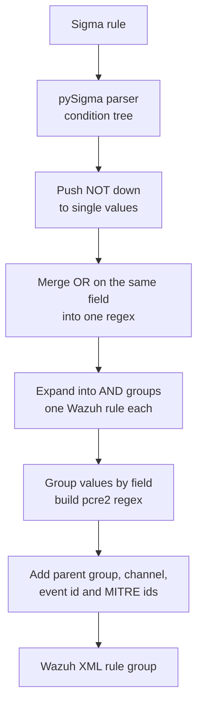

**Field mapping.** For Windows rules, Sysmon and Security fields become Wazuh eventchannel fields: `Image` becomes `win.eventdata.image`, `CommandLine` becomes `win.eventdata.commandLine`, and `EventID` becomes `win.system.eventID`. System fields such as `Channel`, `Provider_Name` and `Computer` map to `win.system.*`.

**Parent and event filter.** The log source decides the parent and extra filters:

| Sigma log source | Wazuh rule gets |
|---|---|
| `category: process_creation` (and other Sysmon categories) | `<if_group>sysmon</if_group>` and the Sysmon event id, for example `1` |
| `category: ps_script` / `ps_module` | `<if_group>windows</if_group>`, the PowerShell channel and event `4104` / `4103` |
| `service: security`, `system`, `powershell` and more | `<if_group>windows</if_group>` and the channel name |
| Other products (Linux and so on) | No parent. Field names stay as they are and a warning is shown |

**Logic.** Wazuh rules are a list of conditions that must all match, so Sigma logic is rewritten:

* Values joined by OR on the same field become one regex such as `(?:\\powershell\.exe|\\pwsh\.exe)$`.
* OR across different fields becomes several Wazuh rules with the same description. The split is capped (default 64) so a rule never explodes.
* AND on the same field, such as `contains|all`, becomes one regex with lookaheads.
* NOT becomes `negate="yes"` or a negative lookahead.
* Matching is case insensitive like Sigma, unless the rule uses the `cased` modifier.

**Example output** for the sample rule `dns_query_tunnel_tools.yml`

```xml
<group name="sigma,">
  <rule id="100100" level="8">
    <if_group>sysmon</if_group>
    <field name="win.system.eventID" type="pcre2">(?s)^22$</field>
    <field name="win.eventdata.queryName" type="pcre2">(?is)(?:\.ngrok\.io|\.ngrok-free\.app|\.trycloudflare\.com|\.loca\.lt)$</field>
    <description>Sigma: DNS Query For Known Tunneling Service Domains</description>
    <info type="text">Sigma rule id 6f708192-a3b4-4c5d-9e6f-708192a3b4c5</info>
    <mitre>
      <id>T1572</id>
    </mitre>
    <group>sigma,sigma_medium,</group>
  </rule>
</group>
```

**Options** (on the Convert page or in the API):

| Option | Default | Why |
|---|---|---|
| First rule id | `100100` | Custom Wazuh rules should use ids from 100000 up |
| Match doubled backslashes | on | Wazuh eventchannel fields keep Windows paths with escaped backslashes (`C:\\Windows`). Turn it off if your decoder gives single backslashes |
| Add if_group parent | on | Ties the rule to the Sysmon or Windows rule tree |

Sigma levels map to Wazuh levels like this: informational 3, low 5, medium 8, high 12, critical 15.

**Install the rules.** Download the `.xml` from the Convert page, copy it to `/var/ossec/etc/rules/` on the manager, and restart it:

```bash
sudo cp sigma-forge_wazuh.xml /var/ossec/etc/rules/sigma_forge_rules.xml
sudo chown wazuh:wazuh /var/ossec/etc/rules/sigma_forge_rules.xml
sudo systemctl restart wazuh-manager
```

#### Correlations in Wazuh

For Wazuh, every converted rule gets a group like `sigma_ref_<name>`. The correlation becomes a rule with `frequency`, `timeframe`, `<if_matched_group>` and `<same_field>` for each `group-by` field:

```xml
<rule id="100101" level="12" frequency="10" timeframe="300">
  <if_matched_group>sigma_ref_sf_failed_logon</if_matched_group>
  <same_field>win.eventdata.ipAddress</same_field>
  <description>Sigma correlation: Brute Force From One Source Address</description>
</rule>
```

#### Test the rules on a real manager

[`tools/wazuh_check.py`](tools/wazuh_check.py) uploads the rules through the Wazuh API (Application Programming Interface), restarts the manager and runs test events through the `logtest` endpoint.

```bash
.venv/bin/python tools/wazuh_check.py \
  --url https://WAZUH_MANAGER:55000 \
  --user wazuh --password 'YOUR_PASSWORD' \
  --rules sigma-forge_wazuh.xml \
  --events sample/wazuh/events.jsonl \
  --insecure
```

On Windows use `.venv\Scripts\python.exe` instead. The password can also come from the `WAZUH_API_PASSWORD` variable. Use `--insecure` only for lab managers with self signed certificates.

Each line of the events file is one test:

```json
{"name": "Certutil download", "expect": "Certutil Used To Download A File", "event": {"win": {"system": {"eventID": "1"}, "eventdata": {"image": "C:\\Windows\\System32\\certutil.exe"}}}}
```

`expect` can be a rule id (`100104`), part of the rule title, or `none` for events that must not fire a Sigma rule. The tool prints PASS or FAIL for each line and exits with code 1 if any test fails, so you can use it in a pipeline.

</details>

## Automatic fallbacks

Many platforms cannot do every Sigma feature, or have no field mapping for some log sources. Instead of failing, Sigma Forge tries again with the closest thing the platform can do, and puts a note on the rule's card so you know what changed:

| Problem | What Sigma Forge does |
|---|---|
| No field or table mapping for the log source | Converts with the original Sigma field names, so you only need to rename fields |
| `cased` not supported | Drops it, so the query matches any case |
| CIDR lists not supported | Turns each range into an IP prefix match |
| Keyword (full text) search not supported | Matches the words against a `message` field |
| `exists` or `null` not supported | Uses a match on any value, or on an empty string |
| Number values break the backend | Sends them as text |
| No Splunk CIM data model for the log source | Falls back to a plain SPL search |

Rules that still fail show the reason on their card. Most of these are platform limits, like QRadar's field list for some log sources.

## Correlation rules

Sigma correlation rules join events from other rules, like "ten failed logons from one address in five minutes". Sigma Forge reads them from the same file as the rules they use.

| Target | Correlation support |
|---|---|
| Splunk SPL | Supported (tested with `event_count` and `value_count`) |
| Elastic ES\|QL | Supported (tested with `event_count` and `value_count`) |
| Elastic EQL | Supported (tested with `event_count` and `value_count`) |
| ElastAlert | Supported (tested with `event_count` and `value_count`) |
| OpenSearch PPL | Supported (tested with `event_count` and `value_count`) |
| Grafana Loki (LogQL) | Supported (tested with `event_count` and `value_count`) |
| ClickHouse SQL | Supported (tested with `event_count` and `value_count`) |
| SQLite (Zircolite) | Supported (tested with `event_count` and `value_count`) |
| Wazuh | `event_count` with `gte` or `gt`, as a `frequency` rule |
| Others | Not supported by their backend. The card shows the reason |

A base rule that is only used by a correlation has no query of its own, so it is shown as **skipped**. Add `generate: true` to the base rule if you also want it alone.

## ATT&CK coverage

The ATT&CK Enterprise data lives in [`data/attack/attack.json`](data/attack/attack.json), a small file (about 130 KB) built from the official [MITRE ATT&CK STIX data](https://github.com/mitre-attack/attack-stix-data). It is included in the repo, so coverage works offline.

Refresh it at any time:

```bash
./setup.sh --update-attack                 # Linux and macOS
.\setup.ps1 -UpdateAttack                  # Windows
.venv/bin/python tools/fetch_attack.py     # direct
```

How tags are read:

* `attack.t1059.001` counts for T1059.001, and rolls up to T1059 on the heat map.
* `attack.execution` style tags count per tactic.
* Revoked techniques are moved to their new id. For example, ATT&CK v20 replaced `T1562.001` with `T1685`. The rule gets a finding and the coverage counts the new id.
* Tags that do not exist at all are listed as unknown.

Below the map, **Coverage by log source** lists every log source your rules use, with rule counts, techniques and levels. When the SigmaHQ library is synced, **Biggest gaps** shows the techniques SigmaHQ covers and you do not, ranked by how many community rules exist for them, and the log sources that would close the most gaps. Click one to open those rules in the library. The technique drawer also lists SigmaHQ rules for that technique with an **Add** button.

## Testing rules on logs

The Test page runs your rules on real events without a SIEM:

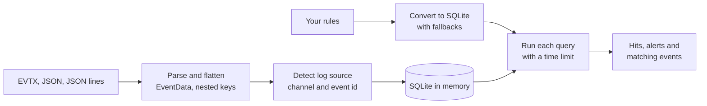

* **Formats.** `.evtx` files are read with the [evtx](https://github.com/omerbenamram/pyevtx-rs) parser. JSON can be one object, an array, an object with `events`, `records`, `logs` or `Records` (CloudTrail), an Elasticsearch `hits` answer, or one event per line. Wazuh `win.*` events and Elastic `_source` wrappers are unwrapped.
* **Fields.** Nested keys are flattened to their last name (`EventData.CommandLine` becomes `CommandLine`) and also kept with their full dotted path (`userIdentity.arn`), so both Windows and cloud rules find their fields. Field names are matched without case. The raw event is kept in a `message` column for keyword searches.
* **Log sources.** For Windows events the channel and event id give the product, service and category (Sysmon event 1 is `process_creation`, PowerShell 4104 is `ps_script` and so on). Other logs can carry a `logsource` object. Three modes decide how strict this is: **auto** only filters events whose log source is known, **strict** always filters, **off** runs every rule on every event.
* **Correlations** run as real SQLite window queries over the event `timestamp`, and each alert shows its group, window and count.
* Limits: 64 MB and 250,000 events per run, and 10 seconds per query. See [configuration](#configuration).

## SigmaHQ library

**Sync now** downloads `sigma_all_rules.zip` from the latest [SigmaHQ release](https://github.com/SigmaHQ/sigma/releases) and indexes it by title, technique, log source, level and status. The files are stored in `data/sigmahq` (a Docker volume when you use compose). On a machine without internet, download the zip yourself and use **Upload zip**. Rules you add are stored as `sigmahq/<path>` in your workspace, so you can tell them apart from your own.

## Field mapping

A mapping profile renames Sigma fields before conversion, for example `CommandLine` to `process.command_line`. Renames apply to detections, `fields` and correlation `group-by`, `aliases` and value fields. Presets for Elastic ECS, Wazuh event data and Splunk CIM are included. **Add fields from workspace** lists every field your rules use, so you only fill in your names. Profiles can be imported from JSON, a pySigma `fieldmappings` block or simple `field: name` lines, and exported as JSON. They are stored in your browser.

## Export packages

**Export package** on the Convert page builds a zip for the current target. Every zip has a `README.md` with install steps and a list of converted, skipped and failed rules, and a `manifest.json` with each rule's file, techniques and warnings.

| Target | Package |
|---|---|
| Splunk SPL, Splunk CIM | Splunk app with `app.conf`, `savedsearches.conf` (one scheduled search per rule, turned off until you enable it) and `default.meta` |
| Splunk SPL2 | One SPL2 module |
| Elastic Lucene, ES\|QL, EQL | `rules.ndjson` for Kibana **Import rules** |
| ElastAlert | One rule file per Sigma rule |
| OpenSearch Lucene | One alerting monitor per rule |
| Sentinel ASIM, Azure Monitor, Defender XDR | `azuredeploy.json` ARM template with scheduled analytics rules, tactics and techniques |
| Google SecOps | One YARA-L 2.0 rule per file |
| Grafana Loki | Loki ruler `rules.yml`, or Grafana alert rules |
| Sumo Logic CSE | Cloud SIEM rules JSON |
| Panther | Simple detection YAML per rule |
| ClickHouse | ClickDetect rules |
| SQLite | Zircolite rule pack |
| Wazuh | One rules XML file for `/var/ossec/etc/rules/` |
| Every target | Query files: one file per rule in the target language |

Correlation rules and rules that needed a fallback go into the main file when its format allows it. Otherwise they are written to an `extra` folder as plain queries and the README says so.

## API

All endpoints take and return JSON, except `/api/test` and `/api/library/upload` (multipart form) and `/api/export` (returns a zip).

| Method | Path | What it does |
|---|---|---|
| `GET` | `/api/health` | App version, pySigma version and ATT&CK data version |
| `GET` | `/api/targets` | Targets with their formats and whether they are installed |
| `GET` | `/api/samples` | Built in sample rules |
| `GET` | `/api/attack` | ATT&CK Enterprise matrix used by the heat map |
| `POST` | `/api/analyze` | Parse and validate rules, return metadata and findings |
| `POST` | `/api/convert` | Convert rules to a target and format |
| `POST` | `/api/coverage` | ATT&CK coverage for the rules |
| `POST` | `/api/coverage/navigator` | ATT&CK Navigator layer JSON |
| `POST` | `/api/coverage/gaps` | Techniques and log sources SigmaHQ covers that the rules do not |
| `POST` | `/api/compare` | Convert the same rules for several targets |
| `POST` | `/api/fields` | Every field the rules use, with counts |
| `GET` | `/api/export/packages` | Export packages offered for each target |
| `POST` | `/api/export` | Build a package zip |
| `POST` | `/api/test` | Run rules on uploaded log files |
| `GET` | `/api/samples/logs` | Built in sample logs |
| `GET` | `/api/library/status` | Library state, release and counts |
| `POST` | `/api/library/sync` | Download the latest SigmaHQ release in the background |
| `POST` | `/api/library/upload` | Load a `sigma_all_rules.zip` you downloaded |
| `GET` | `/api/library/search` | Search by `q`, `technique`, `product`, `category`, `service`, `level`, `status`, `group` |
| `POST` | `/api/library/rules` | Get the content of library rules by path |

Rules are always sent as a list of `{name, content}` objects:

```bash
curl -s http://127.0.0.1:8000/api/convert \
  -H "Content-Type: application/json" \
  -d '{
        "target": "defender_xdr",
        "format": "default",
        "rules": [{"name": "whoami.yml", "content": "title: Whoami\nlogsource:\n  product: windows\n  category: process_creation\ndetection:\n  sel:\n    Image|endswith: \"\\\\whoami.exe\"\n  condition: sel\nlevel: low"}]
      }'
```

Targets with extra settings take them in `options`:

```json
{"target": "wazuh", "rules": [], "options": {"wazuh_rule_id_start": 110000, "wazuh_double_backslash": false, "wazuh_parent_group": true}}
```

`/api/convert`, `/api/compare` and `/api/export` also take a `field_mapping` object, for example `{"CommandLine": "process.command_line"}`. Export takes `package` (an id from `/api/export/packages`, or `auto`) and `name`.

Test rules on logs with a multipart form:

```bash
curl -s http://127.0.0.1:8000/api/test \
  -F 'rules=[{"name":"r.yml","content":"..."}]' \
  -F mode=auto \
  -F files=@sample/logs/windows_sysmon.jsonl \
  -F files=@Security.evtx
```

## Configuration

Set these as environment variables. See [`.env.example`](.env.example).

| Variable | Default | Meaning |
|---|---|---|
| `SIGMA_FORGE_HOST` | `127.0.0.1` | Bind address (`0.0.0.0` in Docker) |
| `SIGMA_FORGE_PORT` | `8000` | Port |
| `SIGMA_FORGE_MAX_RULES` | `5000` | Most files per request |
| `SIGMA_FORGE_MAX_RULE_BYTES` | `262144` | Largest file size per rule file |
| `SIGMA_FORGE_WAZUH_ID_START` | `100100` | Default first Wazuh rule id |
| `SIGMA_FORGE_WAZUH_MAX_SPLIT` | `64` | Most Wazuh rules made from one Sigma rule |
| `SIGMA_FORGE_MAX_LOG_BYTES` | `67108864` | Largest total upload for a log test (64 MB) |
| `SIGMA_FORGE_MAX_LOG_EVENTS` | `250000` | Most events in one log test |
| `SIGMA_FORGE_LOG_QUERY_SECONDS` | `10` | Time limit for each rule query in a log test |
| `SIGMA_FORGE_SIGMAHQ_DIR` | `data/sigmahq` | Where the SigmaHQ library is stored |
| `SIGMA_FORGE_SIGMAHQ_URL` | latest release zip | Where **Sync now** downloads the library from |
| `WAZUH_API_URL` | `https://127.0.0.1:55000` | Used by `wazuh_check.py` |
| `WAZUH_API_USER` | `wazuh` | Used by `wazuh_check.py` |
| `WAZUH_API_PASSWORD` | none | Used by `wazuh_check.py` |

## Architecture

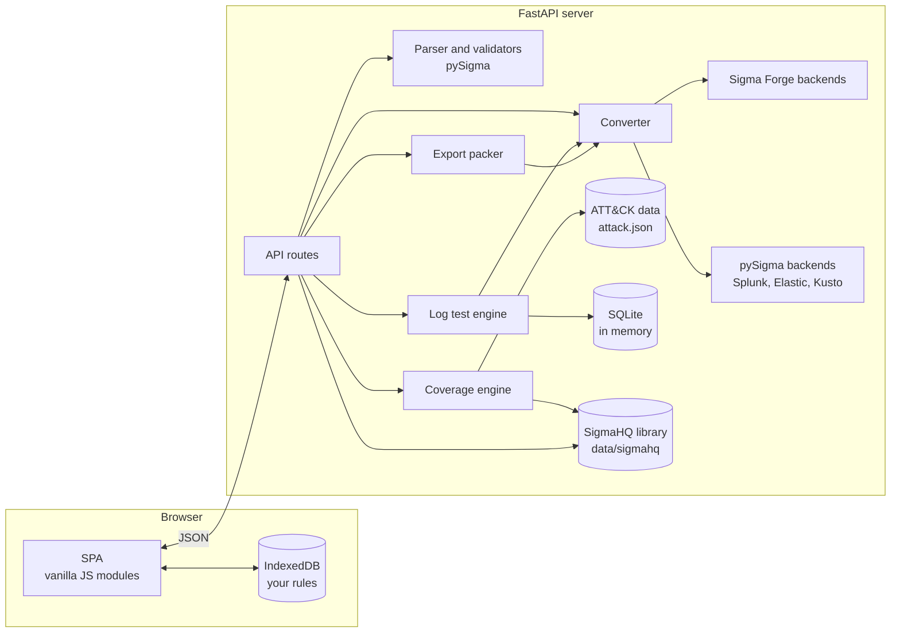

* The server never stores your rules. Each request carries the rules it needs. The only thing it keeps on disk is the SigmaHQ library you sync. Mapping profiles and the editor draft live in your browser.
* ATT&CK data for the Elastic SIEM rule formats comes from the local `attack.json`, so no conversion needs internet.
* The SPA uses the History API for clean URLs (`/convert`, `/coverage`, `/editor`, `/test`, `/library` and so on). FastAPI returns `index.html` for any path that is not an API route or an asset.
* All colors come from [`web/assets/css/root.css`](web/assets/css/root.css). The rest of the CSS only uses its variables, so changing that one file restyles the whole app, both themes included.

## Project layout

```text
Sigma-Forge/
├── app/
│   ├── main.py                  FastAPI app, static files, SPA fallback
│   ├── config.py                Paths and environment settings
│   ├── schemas.py               Request models
│   ├── api/
│   │   └── routes.py            /api endpoints
│   └── core/
│       ├── parsing.py           Load YAML into pySigma rules
│       ├── analyzer.py          Metadata and validators
│       ├── converter.py         Run every conversion
│       ├── targets.py           Target list, backends and pipelines
│       ├── coverage.py          ATT&CK coverage and Navigator layer
│       ├── attack.py            ATT&CK data and tag helpers
│       ├── offline_attack.py    Feeds local ATT&CK data to pySigma
│       ├── fieldmap.py          Custom field mapping
│       ├── logtest.py           EVTX and JSON loading, SQLite test runs
│       ├── library.py           SigmaHQ sync, index and search
│       ├── export.py            Ready to deploy packages
│       └── wazuh/
│           ├── backend.py       Sigma to Wazuh XML
│           └── mapping.py       Log source and field mapping
├── web/
│   ├── index.html               SPA shell
│   └── assets/
│       ├── css/
│       │   ├── root.css         Theme tokens (the only place with colors)
│       │   └── app.css          Layout and components
│       ├── js/
│       │   ├── app.js           Startup, theme, header
│       │   ├── router.js        History API router
│       │   ├── api.js           API client
│       │   ├── store.js         IndexedDB rule store
│       │   ├── state.js         Shared cache
│       │   ├── ui.js            Helpers, drawer, toasts, skeletons
│       │   ├── mappings.js      Field mapping profiles
│       │   └── views/           workspace, convert, coverage, rules, editor,
│       │                        compare, test, library, mappings
│       └── img/                 Animated logo (logo.gif), logo, banners, screenshots
├── data/attack/attack.json      Compact ATT&CK Enterprise data
├── sample/
│   ├── rules/                   Sample pack by feature (windows, linux, network,
│   │                            cloud, modifiers, correlation, collections, broken)
│   │                            and the ATT&CK pack (attack, 227 rules)
│   ├── logs/                    Sample logs for the Test page
│   ├── wazuh/events.jsonl       Wazuh logtest events
│   └── api/                     API request bodies and run_examples scripts
├── tools/
│   ├── fetch_attack.py          Build attack.json from MITRE STIX
│   └── wazuh_check.py           Upload and test rules on a Wazuh manager
├── tests/                       pytest suite
├── setup.sh                     Linux and macOS setup
├── setup.ps1                    Windows setup
├── Dockerfile
├── docker-compose.yml
├── requirements.txt             Core packages and 20 pySigma backends
├── requirements-legacy.txt      Older backends installed with --no-deps
└── requirements-dev.txt
```

## Development

```bash
./setup.sh --dev            # or .\setup.ps1 -Dev
.venv/bin/python -m pytest -q
.venv/bin/python -m uvicorn app.main:app --reload
```

The tests cover the API, every target, error handling, correlations, coverage, the ATT&CK pack, log tests, field mapping, compare and every export package format. The backend tests compile the generated regex and check it against real looking field values, so they catch broken escaping and wrong logic, not only bad XML.

Adding a sample rule is as simple as dropping a `.yml` file anywhere under `sample/rules/`. It shows up under **Load samples** right away.

## Known limits

* **Feature support differs per target.** Some backends cannot do number compare, `fieldref`, `cidr`, case sensitive matching or keyword search. Those rules show the reason on their card. The [target guide](#target-guide) lists the most common failures for each target.
* **Correlation rules** only convert on targets whose backend supports them (see [correlation rules](#correlation-rules)). Base rules must be in the same file.
* **Log tests** use SQLite, so they show whether a rule's logic matches an event, not how a given SIEM parses your logs. Field names in your logs must match the rule (or a mapping profile). Regex follows Python rules.
* **The ATT&CK pack** covers every parent technique. Sub techniques are covered where a rule targets one, not one by one.
* **Pipelines** only know the log sources their authors mapped. Rules for other log sources show the pySigma error on their card.
* **Elastic Lucene** regex is not PCRE (Perl Compatible Regular Expressions), so rules with complex `re` values may need a manual check.

## Credits

* [SigmaHQ](https://github.com/SigmaHQ) for the Sigma format and [pySigma](https://github.com/SigmaHQ/pySigma) with its backends and pipelines.
* [MITRE ATT&CK®](https://attack.mitre.org/). © The MITRE Corporation. This work is reproduced and distributed with the permission of The MITRE Corporation.
* Splunk, Elastic, OpenSearch, Microsoft, CrowdStrike, SentinelOne, Palo Alto Networks, Google, Broadcom, IBM, Logpoint, RSA, Sumo Logic, Panther, Trellix, Grafana, Quickwit, ClickHouse, SurrealDB and Wazuh are trademarks of their owners. Sigma Forge is not tied to any of them.

<div align="center">
<sub>Built by <a href="https://qayssarayra.com">Qays Sarayra</a></sub>
</div>
